# ColaboraCar — Documento técnico y plan de trabajo

2026-10-08 · Manuel

## 1. Resumen y alcance

ColaboraCar es una aplicación de movilidad colaborativa para la comunidad de la UTP. Los conductores publican viajes hacia o desde su sede, y los pasajeros reservan asientos pagando con créditos que recargan en su billetera. Este documento es la fuente de verdad de los requerimientos, la arquitectura y los flujos principales. Se basa en los mockups de `frames/` y en el documento del curso (`proyecto_diseno_productos.docx`). Cuando el docx, los frames o el código no coinciden con este documento, se corrigen ellos (sección 12).

| Elemento | Definición |
| --- | --- |
| Actores | **Pasajero**: busca, reserva y paga viajes con créditos, y califica al conductor. **Conductor**: registra su vehículo con SOAT, publica, inicia y finaliza viajes, califica a sus pasajeros y retira lo que gana. Un usuario alterna entre ambos modos desde el perfil (RF-14). **Sistema (job)**: proceso programado del backend que cancela los viajes no iniciados, cierra los viajes en curso, envía recordatorios y recalcula estadísticas. **Operador (BD)**: miembro del equipo que paga o rechaza los retiros editando la base de datos; no tiene pantallas. |
| Usuario con discapacidad | **Pasajero con movilidad reducida** (silla de ruedas, muletas o andador). No es un rol aparte: es un pasajero que declara su necesidad de asistencia en el perfil (RF-02, RF-14). |
| Frontend | React 18 + TypeScript + Vite + Tailwind CSS, incrustado en un WebView móvil. Mapas con Leaflet y OpenStreetMap. |
| Backend | API REST con Spring Boot 4 (Java 25), Spring Security, Spring Validation y Spring Data MongoDB. Los procesos programados usan `@Scheduled`. |
| Base de datos | MongoDB Atlas (NoSQL orientada a documentos, clúster administrado en la nube). Los parámetros de negocio configurables están en la colección `app` (RN-31). |
| Módulos | Autenticación, registro, viajes (búsqueda, reserva, publicación, ejecución y cancelación), historial y calificaciones, billetera, notificaciones y perfil. |

Estado actual: el backend (`app-movilidad-colaborativa-api/`) ya implementa la autenticación con OTP en cada login, el registro, los catálogos, los vehículos, la publicación, el listado por sede, la reserva y el perfil sobre MongoDB Atlas: 18 de los 19 endpoints del contrato (`docs/openapi.yaml`). Solo falta la carga de imágenes. El frontend implementa las 16 pantallas de `frames/`. En desarrollo puede usar el backend real o una API simulada con MSW (`VITE_USE_MOCKS`). Todo lo demás de este documento todavía no está implementado (sección 10). El detalle está en la sección 4.1.

### 1.1 Fuera del alcance

- **Pagos reales:** la recarga con Yape es simulada. El usuario ingresa el código de operación como referencia, pero la app no lo verifica contra Yape y aprueba la recarga al instante (RN-41). No hay pasarela, tarjeta ni comisión de la plataforma.
- **Pago automático de retiros:** el retiro queda pendiente y un operador lo paga a mano por Yape, registrándolo en la base de datos (RF-12).
- **Validación automática del SOAT:** no hay API oficial (APESEG y la SBS solo tienen consulta web), y las APIs de terceros son de pago. El conductor declara su SOAT y sube la foto del certificado, pero nadie la revisa (RN-36).
- **Chat** entre conductor y pasajeros, y **acuerdos de paradas adicionales**: las paradas las define el conductor y son referenciales (RN-29). Si pasajero y conductor acuerdan otra parada, lo hacen fuera de la app.
- **Notificaciones push, por correo o por SMS.** En este alcance las notificaciones llegan a una bandeja dentro de la app (RF-13). El push llega con la integración en apps nativas (WebView embebido), que reutiliza la misma colección `notificaciones`.
- **Recomendación con IA y coincidencia automática de rutas** (RF09 a RF11 del docx). La búsqueda es con filtros (RF-03).
- **Perfil Administrador** (gestión de usuarios, incidencias, reportes y condiciones de la plataforma; RF16 a RF20 del docx). Las cuentas `BLOQUEADO`, los retiros y la colección `app` se editan directamente en la base de datos.
- **Botón de emergencia, reporte de incidencias y compartir el viaje con un contacto.**
- **Mapas avanzados:** trazado de rutas por calles, búsqueda de direcciones, tráfico en tiempo real, búsqueda por cercanía y seguimiento del vehículo en vivo.
- **Recuperación y cambio de contraseña**, gestión de los dispositivos confiables y edición de un viaje ya publicado (se cancela y se publica de nuevo).
- **«Cambiar sede» y «Modificar casa»** de los frames 13 y 14, y los distintivos «A/C activo» y «Conductor frecuente» del frame 09: se quitan del prototipo.

### 1.2 Supuestos y restricciones

- Todos los usuarios son estudiantes UTP con correo `@utp.edu.pe`. La verificación de pertenencia es el OTP enviado a ese correo la primera vez que el usuario entra desde cada dispositivo.
- La hora de referencia es la de Perú (UTC−5) para todas las reglas de horario.
- 1 sol = 1 crédito. Los créditos son enteros y no vencen.
- El dato de movilidad reducida es un dato de salud y por eso es **dato sensible** según la Ley 29733 de Protección de Datos Personales. Se guarda solo con consentimiento expreso (RN-17). El número de Yape de un retiro solo lo ven su dueño y el operador.
- El tier de Atlas del proyecto no admite Scheduled Triggers, así que los procesos programados corren en el backend con `@Scheduled` de Spring Boot (RF-08).
- El ahorro de CO₂ usa 0,18 kg de CO₂ por km: es la huella de un auto sedán a gasolina con un ocupante en Perú, unos 180 gCO₂eq/pas-km con un consumo de ~7,6 L/100 km ([Santa María-Dávila et al., *Tecnia* 34(2), 2024](https://revistas.uni.edu.pe/index.php/tecnia/article/view/1928)). Se supone que cada plaza compartida evita un viaje en auto de la misma distancia. No hay un factor oficial por ciudad para la costa; el valor es configurable en `app` (RN-31).

## 2. Requerimientos funcionales (RF)

Son 14 requerimientos, uno por objetivo de usuario, para que cada uno tenga su storyboard. Cuando un requerimiento cubre varios caminos, sus casuísticas están en el criterio de aceptación (2.1). Los formatos y límites están en las reglas de negocio (2.2). La columna Pantalla indica el mockup de `frames/` (17 a 21 son pantallas nuevas, sección 2.4). La columna Antes indica los IDs de la versión anterior de este documento.

| ID | Módulo | Requerimiento | Actor | Pantalla | Antes |
| --- | --- | --- | --- | --- | --- |
| RF-01 | Autenticación | El usuario inicia sesión con correo institucional y contraseña. El sistema le pide un código OTP solo la primera vez que entra desde un dispositivo. También puede cerrar sesión. | Ambos | 01, 02, 13, 14 | RF-01 |
| RF-02 | Registro | El usuario crea su cuenta y completa su perfil, incluida su necesidad de asistencia si la tiene. Si tiene vehículo, lo registra con su accesibilidad y su SOAT, y queda habilitado como conductor. | Ambos | 03, 04, 05 | RF-02 a RF-04 |
| RF-03 | Viajes | El pasajero busca los viajes publicados de todas las sedes, cada uno con la etiqueta de su ciudad, y los filtra. También consulta el detalle de un viaje con su ruta, condiciones, vehículo, accesibilidad y conductor. | Pasajero | 06, 07, 09 | RF-05, RF-06 |
| RF-04 | Viajes | El pasajero reserva plazas en un viaje pagando con créditos, que quedan retenidos hasta que el viaje termina. Solo puede tener una reserva activa a la vez. | Pasajero | 08, 10 | RF-07 |
| RF-05 | Viajes | El conductor publica un viaje: traza la ruta y sus paradas en el mapa, y define sentido, hora de salida, precio por plaza, plazas y condiciones. Antes de guardarlo confirma un resumen. | Conductor | 11, 12 | RF-08 |
| RF-06 | Mis viajes | El usuario consulta sus viajes próximos y en curso. El pasajero puede cancelar su reserva y el conductor su viaje, hasta 30 minutos antes de la salida, con reembolso a los pasajeros y un límite de cancelaciones. | Ambos | 17 | RF-09 a RF-11 |
| RF-07 | Mis viajes | El conductor confirma el inicio del viaje, marcando qué pasajeros subieron, y lo finaliza al llegar. Los pasajeros reciben un aviso en cada paso. | Conductor | 17 | — |
| RF-08 | Sistema | Un proceso programado cancela los viajes que no se iniciaron a tiempo, cierra los viajes en curso 15 minutos después de su llegada estimada, liquida los créditos, envía recordatorios y recalcula las estadísticas. | Sistema (job) | — | RF-12 |
| RF-09 | Historial | El usuario consulta su historial de viajes terminados, cancelados o perdidos, como pasajero y como conductor. | Ambos | 19 | — |
| RF-10 | Calificaciones | Al terminar un viaje, el pasajero califica al conductor y el conductor a cada pasajero que subió, con 1 a 5 estrellas y un comentario opcional. Tienen 7 días para hacerlo. | Ambos | 19, 20 | — |
| RF-11 | Billetera | El usuario consulta su saldo disponible y retenido y sus movimientos, y recarga créditos con un pago simulado por Yape. | Ambos | 21 | — |
| RF-12 | Billetera | El conductor solicita el retiro de los créditos que ganó a su número de Yape. Un operador lo paga o lo rechaza desde la base de datos. | Conductor | 21 | — |
| RF-13 | Notificaciones | El usuario recibe en una bandeja de la app los avisos de sus reservas, viajes, cancelaciones, recordatorios y calificaciones pendientes, y los marca como leídos. | Ambos | 18 (y campana en 06) | RF-16 |
| RF-14 | Perfil | El usuario consulta y actualiza su perfil: datos personales, asistencia de movilidad, documento, vehículo y SOAT. También cambia de modo entre pasajero y conductor, con un modal de confirmación. | Ambos | 13, 14, 15, 16 | RF-13 a RF-15 |

### 2.1 Criterios de aceptación

Los mensajes entre comillas son literales: los devuelve la API (`app-movilidad-colaborativa-api/README.md`) o los muestra el frontend. Los que dicen «(nuevo)» todavía no existen en el código. Los valores entre paréntesis después de un parámetro, como `minutos_limite_cancelacion` (30), son los valores por defecto de la colección `app` (RN-31).

- **RF-01 — Acceder y cerrar sesión.**
  - **Credenciales.** El correo es `@utp.edu.pe` (RN-01). Con credenciales inválidas: «Correo o contraseña incorrectos», sin revelar si el correo existe. Con una cuenta `BLOQUEADO`: «Tu cuenta está bloqueada. Comunícate con soporte.».
  - **Dispositivo confiable** (RN-35). El frontend envía un identificador de dispositivo que genera la primera vez y guarda en el WebView. Si ese dispositivo ya es confiable para la cuenta y no venció, el login entrega el token `SESSION` (8 h) y abre el dashboard sin pedir OTP.
  - **Dispositivo nuevo o vencido.** Se envía el OTP al correo y se entrega un token `PRE_AUTH` (10 min), que solo sirve para verificar o reenviar el código. El OTP expira a los 5 min y admite 3 intentos: «Código inválido. Te quedan N intentos.» y luego «Agotaste los intentos. Solicita un nuevo código.». Se puede reenviar a los 45 s; antes de eso: «Podrás reenviar el código en N segundos». Con el código correcto, el dispositivo queda como confiable por `dias_dispositivo_confiable` (90) y se entrega `SESSION`.
  - **Perfil incompleto.** Si la cuenta está en `PERFIL_PENDIENTE`, después del login se abre «Completar perfil» (RF-02, casuística D).
  - **Cerrar sesión.** Se hace desde el menú o desde el perfil: se descarta el token y se vuelve a la pantalla 01. El dispositivo sigue siendo confiable.
- **RF-02 — Registro.** Es un solo flujo en tres pasos: cuenta (03), perfil (04) y vehículo (05). Casuísticas:
  - **A. Pasajero.** Correo `@utp.edu.pe` (RN-02) y no registrado; si ya existe: «El correo ya está en uso». Contraseña según RN-03 e igual a su confirmación, y check de términos obligatorio. Esto crea el usuario en `PERFIL_PENDIENTE` con rol `PASAJERO` y entrega un token `REGISTRATION` (15 min). En el perfil, los campos van según RN-04 y RN-05, y departamento, distrito y sede se eligen en cascada (un distrito ajeno da «El distrito no pertenece al departamento»). Al guardar, la cuenta pasa a `ACTIVO` con saldo 0, el dispositivo queda como confiable y se abre el dashboard en modo pasajero.
  - **B. Pasajero con movilidad reducida.** Es igual que A, más la sección opcional «Necesito asistencia de movilidad»: tipo (`Silla de ruedas`, `Muletas o andador`, `Otra`), nota de hasta 120 caracteres y check de consentimiento, obligatorio si se marca la sección (RN-17).
  - **C. Conductor.** Es A o B, más el check «Tengo vehículo», que al guardar el perfil abre «Datos del vehículo». Los campos van según RN-06 a RN-09, y la placa no puede repetirse: «La placa ya está registrada». Los checks de accesibilidad son opcionales (RN-18). La sección **SOAT** es obligatoria (RN-36): aseguradora, número de póliza, fechas de inicio y fin, y foto del certificado. Al guardar, el usuario suma el rol `CONDUCTOR`, el vehículo queda `ACTIVO` y se abre el dashboard en modo conductor.
  - **D. Abandona a la mitad.** Si sale después del paso 03, la cuenta queda en `PERFIL_PENDIENTE`. Al iniciar sesión se retoma «Completar perfil» (RF-01). Si sale en el paso 05, la cuenta ya está `ACTIVO` como pasajero y puede registrar el vehículo después, desde el perfil (RF-14).
  - **E. SOAT no vigente.** Si la fecha de fin ya pasó o la de inicio es futura: «Tu SOAT no está vigente. No puedes registrar el vehículo sin un SOAT vigente.» (nuevo). El vehículo no se guarda; el usuario puede corregir los datos o continuar como pasajero con «Omitir por ahora».
- **RF-03 — Buscar y consultar viajes.** La búsqueda no depende de la sede del usuario (RN-49). Escenarios:
  - **Listado.** Muestra los viajes disponibles de todas las sedes, ordenados por hora de salida, 20 por página con carga al hacer scroll. No incluye los viajes propios. Cada tarjeta muestra aporte por plaza, vehículo, asientos libres, hora de salida, conductor con su calificación, y una etiqueta discreta con la ciudad de la sede (p. ej., «Trujillo», «Lima Centro», «Lima Norte»). Si el vehículo es apto, también muestra un ícono con el texto accesible «Vehículo apto para silla de ruedas plegable».
  - **Filtros.** Destino (texto contenido en la etiqueta, sin distinguir mayúsculas ni tildes), hora mínima de salida (6:00 a 23:00), pasajeros (1 a 10; solo viajes con al menos esa cantidad de plazas libres) y «Solo vehículos accesibles» (RN-19). Los filtros se combinan.
  - **Sin resultados.** «No hay viajes disponibles con estos filtros» (nuevo).
  - **Condiciones.** El ícono de información de la tarjeta abre un modal con las condiciones del conductor (hasta 10).
  - **Detalle.** Muestra el mapa con origen, paradas y destino unidos por líneas rectas y, debajo, la misma ruta como lista ordenada en texto (RNF-11), con la leyenda «Paradas referenciales definidas por el conductor» (RN-29). También muestra la distancia en línea recta, la duración estimada a 35 km/h, la ciudad, el vehículo, la accesibilidad (RN-18), los asientos libres, el conductor con su calificación y, siempre visible, la lista de **condiciones del viaje**.
  - **Ya tiene una reserva activa.** Puede ver tarjetas y detalles, pero el botón «Reservar» aparece deshabilitado con el texto «Ya tienes una reserva activa. Cancélala para reservar otro viaje.» (RN-23, nuevo).
  - **Bloqueado por cancelaciones.** El botón «Reservar» aparece deshabilitado con el mensaje de RN-38.
  - **Viaje que ya no está disponible.** Si se abre un viaje que ya no está `PUBLICADO`: «Este viaje ya no está disponible».
- **RF-04 — Reservar.**
  - **Precondiciones.** El viaje está `PUBLICADO` con salida futura. No es propio: «No puedes reservar tu propio viaje». El pasajero no tiene otra reserva activa (RN-23) ni está bloqueado por cancelaciones (RN-38). Puede reservar de 1 plaza a las plazas disponibles.
  - **Confirmación.** El modal muestra ruta, conductor, total (plazas × precio por plaza) y saldo disponible después de reservar. Si el pasajero declaró «Silla de ruedas» y el vehículo no es apto, muestra el aviso de RN-20 y permite continuar.
  - **Saldo insuficiente.** «Saldo insuficiente: necesitas N créditos y tienes M.», con el botón «Recargar» que abre la billetera (RN-39, nuevo).
  - **Efecto, en una sola transacción:** se crea la reserva `CONFIRMADA` con la copia de la necesidad de asistencia (RN-21), se descuentan las plazas, se retienen los créditos (el saldo disponible baja y el retenido sube, y se registra el movimiento `RETENCION_RESERVA`), y se crea la notificación «Nueva reserva» para el conductor (RN-32).
  - **Concurrencia.** Si otro pasajero tomó la última plaza al mismo tiempo: «Este viaje ya no tiene asientos disponibles», y no se crea nada ni se retiene saldo.
- **RF-05 — Publicar viaje.**
  - **Precondiciones.** El usuario está en modo conductor y tiene un vehículo `ACTIVO` (RN-24): «Registra un vehículo para usar la modalidad de conductor (o para publicar viajes)». Su SOAT está vigente en la fecha de salida (RN-37): «Tu SOAT vence antes de la salida. Actualízalo en tu perfil para publicar.» (nuevo). No superó el límite de cancelaciones (RN-30): «Cancelaste N viajes en los últimos 30 días. Podrás publicar de nuevo desde el DD/MM.» (nuevo).
  - **Ruta.** El conductor toca el mapa para fijar origen, destino y hasta 5 paradas, que se pueden mover; son las únicas paradas del viaje (RN-29). Los demás campos van según RN-10 a RN-13, con hasta 10 condiciones de texto.
  - **Resumen.** Muestra ruta, hora, precio, plazas y las condiciones tal como las verá el pasajero en el detalle (RF-03). Solo al confirmar se guarda el viaje `PUBLICADO`, con `plazas_disponibles = plazas_totales`. Desde ese momento aparece en el dashboard de todas las sedes. Si sale antes de confirmar, no se guarda nada.
- **RF-06 — Mis viajes y cancelaciones.**
  - **Pasajero.** Ve su reserva activa (`CONFIRMADA` o `EN_VIAJE`) con el viaje, el conductor y el estado. Además, durante 24 h, ve las reservas que le canceló el conductor o el sistema, con la etiqueta «Cancelado por el conductor» o «Cancelado: el viaje no se inició».
  - **Conductor.** Ve sus viajes `PUBLICADO` y `EN_CURSO`. Por cada uno ve sus pasajeros, las plazas de cada uno, su calificación y, si la tienen, su necesidad de asistencia (RN-22). Arriba ve el contador «N de M viajes cancelados en los últimos 30 días» (RN-30).
  - **Orden y lista vacía.** La salida más próxima va primero. Sin elementos: «No tienes viajes próximos».
  - **Pasajero cancela** (RN-25). La reserva debe estar `CONFIRMADA` y faltar 30 min o más para la salida. Pide confirmación: «¿Cancelar tu reserva? Te devolveremos N créditos. Llevas K de 5 cancelaciones este mes.». Efecto, en una transacción: la reserva pasa a `CANCELADA` con `cancelada_por = PASAJERO`, las plazas vuelven al viaje, se devuelve el 100 % de lo retenido (movimiento `REEMBOLSO`) y se notifica al conductor. Fuera de plazo: «Ya no puedes cancelar: faltan menos de 30 minutos para la salida». Después de cancelar puede reservar otro viaje.
  - **Conductor cancela** (RN-26). El viaje debe estar `PUBLICADO` y faltar 30 min o más para la salida. El motivo es opcional, de hasta 200 caracteres. Pide confirmación: «¿Cancelar el viaje? Se cancelarán las N reservas confirmadas y se devolverán sus créditos.». Si con esta cancelación llega al límite, agrega: «Con esta cancelación no podrás publicar viajes hasta el DD/MM.». Efecto, en una transacción: el viaje pasa a `CANCELADO` con `cancelado_por = CONDUCTOR`, cada reserva `CONFIRMADA` pasa a `CANCELADA` con reembolso del 100 %, y cada pasajero recibe la notificación «Viaje cancelado». Fuera de plazo: «Ya no puedes cancelar: faltan menos de 30 minutos para la salida. Si no puedes hacer el viaje, no lo inicies y se cancelará solo.».
- **RF-07 — Iniciar y finalizar viaje (nuevo).**
  - **Iniciar** (RN-43). El botón «Iniciar viaje» de Mis viajes se habilita desde `minutos_inicio_anticipado` (15) antes de la salida y hasta `minutos_tolerancia_inicio` (30) después. Abre el modal «¿Quiénes subieron?» con cada pasajero y el check «Subió», marcado por defecto. El conductor confirma con «Confirmar inicio». Efecto, en una transacción: el viaje pasa a `EN_CURSO` con `fecha_inicio`. Las reservas marcadas pasan a `EN_VIAJE` y reciben la notificación «Viaje iniciado». Las no marcadas pasan a `NO_SE_PRESENTO`, cuentan para el límite del pasajero (RN-38) y reciben la notificación «No te presentaste». Sus créditos siguen retenidos y se pagan al conductor al cerrar el viaje (RN-40).
  - **Sin pasajeros.** Si el viaje no tiene reservas, el modal solo pide confirmar.
  - **Finalizar.** Mientras el viaje está `EN_CURSO`, el botón «Finalizar viaje» pide confirmación. Efecto, en una transacción: el viaje pasa a `COMPLETADO` con `fecha_fin`, las reservas `EN_VIAJE` pasan a `COMPLETADA`, los créditos se liquidan (RN-40), y conductor y pasajeros reciben «Viaje completado» con la invitación a calificar.
  - **Cambio de modo durante el viaje.** No se puede cambiar de modo con un viaje `EN_CURSO` (RN-48).
- **RF-08 — Procesos programados (nuevo).** Un job `@Scheduled` del backend se ejecuta cada minuto. Cada tarea es idempotente y segura con varias instancias: cada cambio es un update condicionado al estado actual, y las estadísticas se recalculan en lugar de sumarse.
  - **No iniciado** (RN-44). Un viaje `PUBLICADO` cuya salida pasó hace más de `minutos_tolerancia_inicio` (30) pasa a `CANCELADO` con `cancelado_por = SISTEMA`. Sus reservas se cancelan con reembolso del 100 % y los pasajeros reciben «Viaje cancelado» con el texto «El conductor no inició el viaje». Cuenta para el límite del conductor (RN-30).
  - **Cierre automático** (RN-27). Un viaje `EN_CURSO` cuya hora `fecha_salida + duracion_min + minutos_cierre_automatico` (15) ya pasó se finaliza igual que en RF-07, con `finalizado_por = SISTEMA`.
  - **Recordatorio** (RN-33). Para un viaje `PUBLICADO` que sale dentro de `minutos_recordatorio` (30) se crea «Recordatorio de salida» para el conductor y sus pasajeros. Al conductor se le agrega «Recuerda iniciar el viaje en la app.».
  - **Estadísticas** (RN-28). Al cerrar o cancelar un viaje se recalculan las estadísticas de su conductor y sus pasajeros.
- **RF-09 — Historial (nuevo).** Lista los viajes terminados del usuario, del más reciente al más antiguo, 20 por página, con pestañas «Como pasajero» y «Como conductor» (RN-50).
  - **Como pasajero:** reservas `COMPLETADA`, `CANCELADA` y `NO_SE_PRESENTO`, con fecha, ruta, conductor, créditos pagados o reembolsados y estado.
  - **Como conductor:** viajes `COMPLETADO` y `CANCELADO`, con fecha, ruta, pasajeros que subieron y créditos cobrados.
  - **Calificar.** Cada viaje completado muestra «Calificar» si todavía se puede (RF-10), o la calificación que ya dio.
  - **Sin viajes:** «Aún no tienes viajes terminados».
- **RF-10 — Calificar (nuevo).** Se abre desde la notificación «Viaje completado» o desde el historial (RN-47).
  - **Quién califica a quién.** El pasajero, si su reserva quedó `COMPLETADA`, califica al conductor. El conductor califica a cada pasajero `COMPLETADA`, uno por uno. A quien no se presentó no se le califica.
  - **Datos.** De 1 a 5 estrellas, obligatorio, y comentario opcional de hasta 200 caracteres.
  - **Plazo.** Hasta `dias_para_calificar` (7) después del fin del viaje; pasado ese plazo: «El plazo para calificar este viaje terminó».
  - **Repetida.** «Ya calificaste a esta persona en este viaje». La calificación no se edita ni se borra.
  - **Efecto.** Se recalcula el promedio y la cantidad en `usuarios.calificacion` del calificado, y se copia en sus viajes activos (si es conductor) o en su reserva activa (si es pasajero). El promedio se muestra en el perfil, en la tarjeta del viaje y en Mis viajes; sin calificaciones se muestra «Nuevo».
- **RF-11 — Billetera y recarga (nuevo).**
  - **Billetera.** Muestra el saldo disponible, los créditos retenidos en reservas activas, el saldo retirable (RN-42) y los movimientos del más reciente al más antiguo, 20 por página, con tipo, monto con signo, fecha y descripción.
  - **Recarga simulada con Yape** (RN-41). El usuario elige un monto (S/ 10, 20, 50 u otro entero entre `recarga_minima` (5) y `recarga_maxima` (200)) y ve el texto «Yapea S/ N y escribe el código de operación que te muestra Yape». La pantalla muestra la leyenda permanente «Modo de prueba: el código no se verifica con Yape». El código de operación es numérico, de 6 a 12 dígitos, y no puede haberse usado antes: «Este código de operación ya fue registrado» (nuevo).
  - **Efecto de la recarga, en una transacción:** se crea el pago `APROBADO`, se registra el movimiento `RECARGA` y sube el saldo disponible. Se muestra «Recargaste N créditos».
- **RF-12 — Retiro de créditos (nuevo).** Lo pide un conductor desde la billetera (RN-42).
  - **Datos.** Monto entero desde `retiro_minimo` (10) hasta el saldo retirable, y número de Yape de 9 dígitos que empieza con 9. Si ya tiene un retiro pendiente: «Ya tienes un retiro pendiente». Si el monto supera lo retirable: «Solo puedes retirar hasta N créditos (lo que ganaste como conductor)».
  - **Efecto, en una transacción:** se crea el retiro `PENDIENTE` y el movimiento `RETIRO` descuenta el saldo. La billetera muestra el retiro con la etiqueta «En proceso».
  - **Pago.** El operador hace el Yape y, en la base de datos, marca el retiro como `PAGADO` con el código de operación y la fecha. Si lo rechaza, lo marca `RECHAZADO` con un motivo. En ese caso, el job (RF-08) devuelve los créditos con el movimiento `REVERSION_RETIRO` y notifica al conductor (RN-42).
- **RF-13 — Notificaciones.**
  - **Campana.** El encabezado del dashboard (06) tiene una campana con el número de notificaciones no leídas (hasta «9+»), con el texto accesible «Notificaciones, N sin leer».
  - **Bandeja (18).** Muestra la más reciente primero, hasta 50. Cada notificación tiene título, mensaje y hace cuánto llegó. Al tocar una, se marca como leída y se abre la pantalla relacionada (Mis viajes, historial, calificar o billetera). El botón «Marcar todas como leídas» las marca todas. Sin notificaciones: «No tienes notificaciones».
  - **Actualización.** El contador se actualiza al abrir la app y cada 60 s mientras está abierta (RNF-16).
  - **Tipos y textos** (RN-32, RN-33):

  | Tipo | Destinatario | Mensaje |
  | --- | --- | --- |
  | Nueva reserva | Conductor | «{Pasajero} reservó {N} plaza(s) en tu viaje del {dd/mm hh:mm}.» + «Necesita asistencia: {tipo}.» si aplica |
  | Reserva cancelada | Conductor | «{Pasajero} canceló su reserva en tu viaje del {dd/mm hh:mm}. Quedan {N} plazas libres.» |
  | Viaje cancelado | Pasajero | «{Conductor} canceló el viaje del {dd/mm hh:mm} a {destino}. Te devolvimos {N} créditos.» + «Motivo: {motivo}» o «El conductor no inició el viaje» |
  | Recordatorio de salida | Conductor y pasajeros | «Tu viaje a {destino} sale a las {hh:mm}.» |
  | Viaje iniciado | Pasajeros que subieron | «Tu viaje a {destino} inició.» |
  | No te presentaste | Pasajero ausente | «El conductor marcó que no subiste al viaje del {dd/mm hh:mm}. Se cobraron {N} créditos.» |
  | Viaje completado | Conductor y pasajeros | «Tu viaje a {destino} terminó. ¡Califica a {nombre(s)}!» + al conductor «Recibiste {N} créditos.» |
  | Retiro rechazado | Conductor | «Tu retiro de {N} créditos fue rechazado: {motivo}. Te devolvimos los créditos.» |
- **RF-14 — Perfil.**
  - **Consultar.** Una sola petición trae los datos, la sede, el estado de cuenta, la calificación, el saldo disponible, las estadísticas (RN-28) y, si es conductor, el vehículo con la fecha de fin de su SOAT. Si el SOAT vence en 15 días o menos, el perfil muestra «Tu SOAT vence el DD/MM». Sin viajes completados, el cumplimiento muestra «—».
  - **Actualizar datos.** Los campos van según RN-14. El correo no se edita. El tipo de documento (DNI: 8 dígitos; CE: 8 a 12 caracteres alfanuméricos) y su número se guardan una sola vez y luego se muestran bloqueados. La necesidad de asistencia se puede activar, cambiar o quitar (RN-17), pero quitarla no cambia las reservas ya hechas.
  - **Vehículo.** Si no tiene, el botón «Registrar vehículo» abre la pantalla 05 (RF-02, casuística C). Si tiene, «Actualizar vehículo» edita los campos según RN-07 a RN-09, RN-15, RN-16, RN-18 y RN-36, incluido el SOAT renovado. La placa nueva no puede estar registrada por otro conductor. Los cambios se copian a sus viajes `PUBLICADO`, y las reservas conservan su copia histórica.
  - **Cambiar de modo** (RN-48). El selector «Pasajero / Conductor» del perfil abre un modal: «¿Cambiar a modo conductor? Verás tus viajes publicados y podrás publicar nuevos.» o «¿Cambiar a modo pasajero? Verás los viajes disponibles para reservar.». Con «Confirmar» se guarda `modo_activo` y se recarga el dashboard; con «Cancelar» no cambia nada. Sin vehículo, el paso a conductor muestra «Registra un vehículo para usar la modalidad de conductor» con el botón «Registrar vehículo». Con un viaje `EN_CURSO`: «No puedes cambiar de modo durante un viaje en curso» (nuevo).

### 2.2 Reglas de negocio (RN)

Son 50 reglas. Las RN-01 a RN-34 conservan su ID de la versión anterior; algunas cambian de texto. La columna Pantalla indica dónde se aplica cada una, y «Garantizada por», qué capa la hace cumplir. Las reglas que valida el frontend las vuelve a validar la API. Los valores entre paréntesis son los de la colección `app` (RN-31).

| ID | Pantalla | Regla | Garantizada por |
| --- | --- | --- | --- |
| RN-01 | 01 — Iniciar sesión | Solo se admiten correos del dominio `utp.edu.pe`. | Aplicación |
| RN-02 | 03 — Registro | Solo se permite registrarse con un correo del dominio `utp.edu.pe`; el correo es único y se guarda en minúsculas. | Aplicación + BD (índice único) |
| RN-03 | 03 — Registro | La contraseña tiene al menos 8 caracteres y combina letras, números y símbolos. | Aplicación |
| RN-04 | 04 — Completar perfil | Todos los datos son obligatorios, incluida la foto, excepto el check «Tengo vehículo» y la sección de asistencia de movilidad. | Aplicación |
| RN-05 | 04 — Completar perfil | Los nombres y los apellidos tienen como mínimo una letra. | Aplicación |
| RN-06 | 05 — Datos del vehículo | Todos los campos son obligatorios, incluido el SOAT, excepto el check «Soy propietario», la foto del vehículo y los checks de accesibilidad. | Aplicación |
| RN-07 | 05 y 16 — Vehículo | La placa respeta el formato de placas del Perú, es única entre conductores y se guarda en mayúsculas. | Aplicación + BD (índice único) |
| RN-08 | 05 y 16 — Vehículo | El año de fabricación es como mínimo 2000 y como máximo el año actual + 1. | Aplicación |
| RN-09 | 05 y 16 — Vehículo | Los asientos son como mínimo 1 y como máximo 10. | Aplicación |
| RN-10 | 11 — Publicar viaje | Todos los campos son obligatorios; las condiciones son opcionales (máximo 10) y las paradas también (máximo 5). | Aplicación |
| RN-11 | 11 — Publicar viaje | Las plazas disponibles son como mínimo 1 y como máximo las plazas del vehículo. | Aplicación |
| RN-12 | 11 — Publicar viaje | La salida es futura y su hora está entre las 6:00 y las 23:00. | Aplicación |
| RN-13 | 11 — Publicar viaje | El monto por plaza es como mínimo 1 y como máximo 10 créditos (1 crédito = S/ 1). | Aplicación |
| RN-14 | 15 — Actualizar datos | Todos los datos son obligatorios, incluida la foto. El tipo y el número de documento se ingresan una sola vez y luego no se pueden modificar; el teléfono sí. | Aplicación |
| RN-15 | 16 — Actualizar vehículo | Todos los datos son obligatorios, incluidas la foto y el SOAT. | Aplicación |
| RN-16 | 16 — Actualizar vehículo | De los checks, solo es obligatorio el de términos y condiciones. | Aplicación |
| RN-17 | 04 y 15 — Perfil | La necesidad de asistencia de movilidad es opcional y solo se guarda si el usuario marca el consentimiento «Autorizo compartir esta información con los conductores de los viajes que reserve». Al quitarla se borran el tipo y la nota del perfil. | Aplicación |
| RN-18 | 05 y 16 — Vehículo | Un vehículo es **apto para movilidad reducida** si su conductor marcó «Puedo llevar una silla de ruedas plegable». Un vehículo de tipo `MOTO` no puede marcar ninguno de los dos checks de accesibilidad. | Aplicación |
| RN-19 | 06 — Dashboard | El filtro «Solo vehículos accesibles» muestra solo los viajes cuyo vehículo es apto (RN-18). | Aplicación |
| RN-20 | 08 y 10 — Confirmar reserva | Si el pasajero declaró «Silla de ruedas» y el vehículo no es apto, se muestra «Este vehículo no está marcado como apto para silla de ruedas. Coordina con el conductor antes de viajar.» y la reserva se permite. | Aplicación |
| RN-21 | 08 y 10 — Confirmar reserva | La reserva guarda una copia de la necesidad de asistencia del pasajero al momento de reservar; cambios posteriores del perfil no la modifican. | Aplicación |
| RN-22 | 17 — Mis viajes | La necesidad de asistencia de un pasajero solo la ven él mismo y el conductor de su reserva activa. Nunca aparece en el dashboard, en el detalle del viaje, en el historial ni en los logs. | Aplicación |
| RN-23 | 06, 08, 09 y 10 — Reserva | Un pasajero tiene como máximo **una reserva activa** (`CONFIRMADA` o `EN_VIAJE`) en total y no puede reservar su propio viaje. Puede ver otras publicaciones, pero no reservarlas hasta que cancele la activa o esta termine. | BD (índice único parcial) + aplicación |
| RN-24 | 06 y 11 — Publicar viaje | Solo los usuarios con un vehículo `ACTIVO` pueden publicar viajes. | Aplicación |
| RN-25 | 17 — Mis viajes | El pasajero puede cancelar su reserva `CONFIRMADA` hasta `minutos_limite_cancelacion` (30) antes de la hora de salida, con reembolso del 100 %. | Aplicación |
| RN-26 | 17 — Mis viajes | El conductor puede cancelar su viaje `PUBLICADO` hasta `minutos_limite_cancelacion` (30) antes de la hora de salida. La cancelación alcanza a todas sus reservas `CONFIRMADA`, con reembolso del 100 %. | Aplicación (transacción) |
| RN-27 | — | Un viaje `EN_CURSO` que el conductor no finalizó se cierra solo cuando pasan `fecha_salida + duracion_min + minutos_cierre_automatico` (15). | Aplicación (job `@Scheduled`) |
| RN-28 | 13 y 14 — Perfil | Estadísticas por usuario, recalculadas por el job: **viajes** = reservas `COMPLETADA` como pasajero + viajes `COMPLETADO` con al menos un pasajero que subió, como conductor. **Cumplimiento** = viajes ÷ (viajes + reservas canceladas por él + reservas `NO_SE_PRESENTO` + viajes que canceló él o el sistema por no iniciarlos) × 100, redondeado. **Ahorro de CO₂** = Σ `distancia_km` × `factor_co2_kg_km` (0,18) por cada plaza completada, en los dos roles. | Aplicación (job `@Scheduled`) |
| RN-29 | 07, 09 y 11 — Viaje | Las paradas las define solo el conductor al publicar y son referenciales. El pasajero no elige ni propone paradas en la app; cualquier acuerdo adicional es externo y debe respetar las condiciones del viaje. | Aplicación |
| RN-30 | 06, 11 y 17 — Publicar / Mis viajes | Un conductor no puede publicar si en los últimos `ventana_cancelaciones_dias` (30) acumuló `max_cancelaciones_conductor` (10) viajes cancelados o más. Cuentan los que canceló él y los que canceló el sistema por no iniciarlos (RN-44). El bloqueo se levanta solo cuando el conteo baja del límite. | Aplicación |
| RN-31 | — | Los parámetros configurables están en un único documento de la colección `app` (`_id: "config"`), con los valores por defecto de la sección 5.1. Se editan en la base de datos y rigen desde la siguiente operación, sin reiniciar el backend. Si falta un valor, se usa el de por defecto. | Aplicación |
| RN-32 | 18 — Notificaciones | Toda operación que genera una notificación (RF-13) la crea en la misma transacción que el cambio de estado: si la operación falla, no queda ninguna notificación. | Aplicación (transacción) |
| RN-33 | 18 — Notificaciones | Cada viaje genera como máximo un recordatorio por destinatario, y no lo genera si el viaje fue cancelado. | Aplicación + BD (marca `recordatorio_enviado`) |
| RN-34 | 18 — Notificaciones | Un usuario solo ve y marca sus propias notificaciones. Las notificaciones se eliminan solas a los 30 días. | Aplicación + BD (índice TTL) |
| RN-35 | 01 y 02 — Login | El OTP se pide solo si el dispositivo no es confiable para esa cuenta o si su confianza venció (`dias_dispositivo_confiable`, 90). Validar el OTP marca el dispositivo como confiable. Cada login exitoso desde un dispositivo confiable actualiza su último uso, pero no extiende el vencimiento. Si la cuenta pasa a `BLOQUEADO`, se eliminan todos sus dispositivos confiables. | Aplicación + BD (índice TTL) |
| RN-36 | 05 y 16 — Vehículo | El SOAT es obligatorio para registrar o actualizar el vehículo: aseguradora (de la lista o «Otra»), número de póliza (6 a 20 caracteres alfanuméricos o guiones), fecha de inicio ≤ hoy ≤ fecha de fin, vigencia de 366 días como máximo y foto del certificado (JPG o PNG de hasta 5 MB). Es una declaración del conductor: la app no la verifica con terceros, y lo indica con la leyenda «SOAT declarado por el conductor» en el detalle del viaje. | Aplicación |
| RN-37 | 11 — Publicar viaje | Solo se publica un viaje si el SOAT del vehículo sigue vigente en la fecha de salida. | Aplicación |
| RN-38 | 06, 08, 09 y 10 — Reserva | Un pasajero no puede reservar si en los últimos `ventana_cancelaciones_dias` (30) acumuló `max_cancelaciones_pasajero` (5) o más entre reservas canceladas por él y reservas `NO_SE_PRESENTO`. Mensaje: «Cancelaste o no te presentaste a N viajes en los últimos 30 días. Podrás reservar de nuevo desde el DD/MM.». El bloqueo se levanta solo. | Aplicación |
| RN-39 | 08 y 10 — Reserva | Para reservar, el saldo disponible debe ser mayor o igual al total. Al reservar, el total pasa de disponible a retenido. El saldo disponible nunca es negativo. | Aplicación + BD (update condicionado) |
| RN-40 | — | **Liquidación** al cerrar un viaje: lo retenido de las reservas `COMPLETADA` y `NO_SE_PRESENTO` se paga al conductor (movimiento `COBRO_VIAJE`) y sale de los retenidos de cada pasajero. Lo retenido de una reserva cancelada vuelve al 100 % al pasajero (movimiento `REEMBOLSO`). No hay comisión. | Aplicación (transacción) |
| RN-41 | 21 — Billetera | La recarga es simulada: monto entero entre `recarga_minima` (5) y `recarga_maxima` (200) soles, y código de operación Yape numérico de 6 a 12 dígitos que no se haya usado antes. Se aprueba al instante y acredita 1 crédito por sol. | Aplicación + BD (índice único) |
| RN-42 | 21 — Billetera | **Retiro:** solo de créditos ganados como conductor. Saldo retirable = mín(saldo disponible, Σ `COBRO_VIAJE` − Σ retiros no rechazados). Monto mínimo `retiro_minimo` (10), un solo retiro `PENDIENTE` a la vez y número de Yape de 9 dígitos que empieza con 9. Los créditos se descuentan al solicitar. Si el operador lo rechaza, el job los devuelve en ≤ 1 min. | Aplicación + BD (índice único parcial) |
| RN-43 | 17 — Mis viajes | Solo el conductor del viaje lo inicia, y solo desde `minutos_inicio_anticipado` (15) antes hasta `minutos_tolerancia_inicio` (30) después de la salida. Al iniciar debe marcar, para cada reserva `CONFIRMADA`, si el pasajero subió o no. | Aplicación |
| RN-44 | — | Un viaje `PUBLICADO` que no se inició hasta `minutos_tolerancia_inicio` (30) después de la salida se cancela solo, con reembolso a los pasajeros, y cuenta para el límite del conductor (RN-30). | Aplicación (job `@Scheduled`) |
| RN-45 | 17 — Mis viajes | El conductor puede finalizar un viaje `EN_CURSO` en cualquier momento después de iniciarlo. | Aplicación |
| RN-46 | 17 — Mis viajes | Un conductor puede tener como máximo un viaje `EN_CURSO` a la vez. | Aplicación |
| RN-47 | 19 y 20 — Calificar | Solo califican los participantes de un viaje `COMPLETADO`: el pasajero con reserva `COMPLETADA` califica al conductor, y el conductor a cada pasajero `COMPLETADA`. Una calificación por autor, calificado y viaje; puntaje entero de 1 a 5; comentario de hasta 200 caracteres; plazo de `dias_para_calificar` (7) desde `fecha_fin`. No se edita ni se borra. | Aplicación + BD (índice único) |
| RN-48 | 13 y 14 — Perfil | Cambiar de modo requiere confirmar en un modal. Para pasar a conductor hace falta un vehículo `ACTIVO`. No se puede cambiar de modo con un viaje `EN_CURSO`, como conductor o como pasajero. | Aplicación |
| RN-49 | 06 — Dashboard | El listado de viajes no filtra por sede: muestra todas las sedes. Cada viaje lleva la etiqueta `ciudad` de su sede, copiada del catálogo al publicar. | Aplicación |
| RN-50 | 19 — Historial | El historial solo muestra estados finales: reservas `COMPLETADA`, `CANCELADA` y `NO_SE_PRESENTO`, y viajes `COMPLETADO` y `CANCELADO`. No hay límite de antigüedad. | Aplicación |

**Conceptos derivados** (se calculan a partir del estado y no se guardan aparte):

- **Viaje disponible** = `PUBLICADO`, con `fecha_salida` futura y `plazas_disponibles` ≥ 1.
- **Viaje activo** = `PUBLICADO` o `EN_CURSO`. Solo en estos estados se actualizan las copias de conductor y vehículo.
- **Reserva activa** = `CONFIRMADA` o `EN_VIAJE`.
- **Vehículo apto** = `vehiculo.accesibilidad.silla_ruedas = true` (RN-18).
- **SOAT vigente en una fecha** = `soat.fecha_inicio` ≤ fecha ≤ `soat.fecha_fin`.
- **Cancelaciones recientes del conductor** = sus viajes `CANCELADO` con `cancelado_por` = `CONDUCTOR` o `SISTEMA` y `fecha_cancelacion` dentro de la ventana.
- **Cancelaciones recientes del pasajero** = sus reservas con `cancelada_por = PASAJERO` o en `NO_SE_PRESENTO`, dentro de la ventana.
- **Saldo retirable** = mín(saldo disponible, Σ `COBRO_VIAJE` − Σ retiros `PENDIENTE` o `PAGADO`).

### 2.3 Estados

**Viaje.**

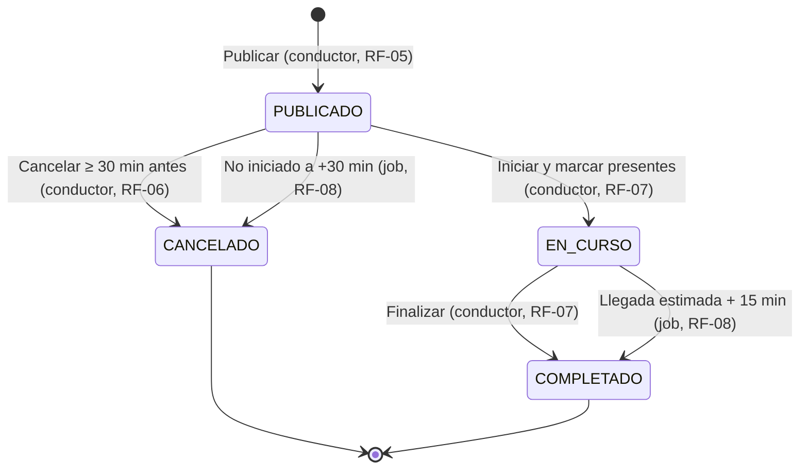

**Reserva.**

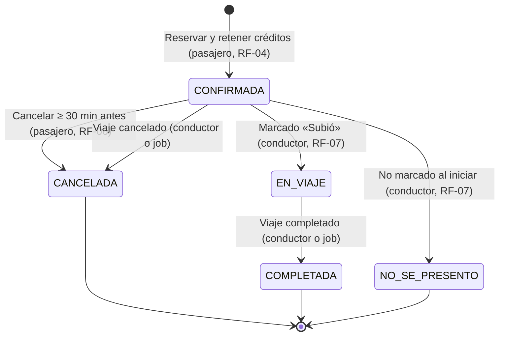

**Retiro.**

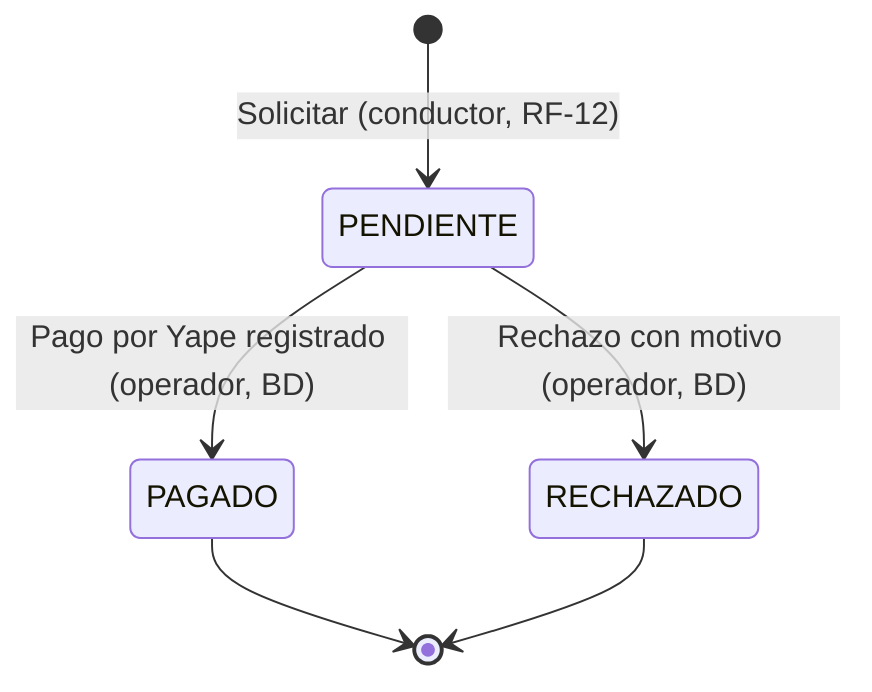

La recarga (`pagos`) nace `APROBADO` porque es simulada (RN-41), así que no tiene transiciones en este alcance.

| Entidad | Transición | Quién | Condición |
| --- | --- | --- | --- |
| Viaje | — → `PUBLICADO` | Conductor | Vehículo `ACTIVO`, SOAT vigente en la salida y sin bloqueo (RN-24, RN-30, RN-37) |
| Viaje | `PUBLICADO` → `EN_CURSO` | Conductor | Dentro de la ventana de inicio (RN-43) y sin otro viaje `EN_CURSO` (RN-46) |
| Viaje | `PUBLICADO` → `CANCELADO` | Conductor | Faltan 30 min o más (RN-26); `cancelado_por = CONDUCTOR` |
| Viaje | `PUBLICADO` → `CANCELADO` | Sistema (job) | No se inició a +30 min de la salida (RN-44); `cancelado_por = SISTEMA` |
| Viaje | `EN_CURSO` → `COMPLETADO` | Conductor | En cualquier momento (RN-45); `finalizado_por = CONDUCTOR` |
| Viaje | `EN_CURSO` → `COMPLETADO` | Sistema (job) | Llegada estimada + 15 min (RN-27); `finalizado_por = SISTEMA` |
| Reserva | — → `CONFIRMADA` | Pasajero | Viaje disponible, sin otra reserva activa, sin bloqueo y con saldo suficiente (RN-23, RN-38, RN-39) |
| Reserva | `CONFIRMADA` → `CANCELADA` | Pasajero | Faltan 30 min o más (RN-25); `cancelada_por = PASAJERO` |
| Reserva | `CONFIRMADA` → `CANCELADA` | Conductor o sistema | Su viaje pasa a `CANCELADO`; `cancelada_por = CONDUCTOR` o `SISTEMA` |
| Reserva | `CONFIRMADA` → `EN_VIAJE` | Conductor | Marcada «Subió» al iniciar |
| Reserva | `CONFIRMADA` → `NO_SE_PRESENTO` | Conductor | No marcada al iniciar |
| Reserva | `EN_VIAJE` → `COMPLETADA` | Conductor o sistema | Su viaje pasa a `COMPLETADO` |
| Retiro | — → `PENDIENTE` | Conductor | RN-42 |
| Retiro | `PENDIENTE` → `PAGADO` o `RECHAZADO` | Operador (BD) | Pago hecho por Yape o motivo de rechazo |

| Estado (BD) | Etiqueta en pantalla |
| --- | --- |
| `PUBLICADO` | Publicado |
| `EN_CURSO` | En curso |
| `COMPLETADO` | Completado |
| `CANCELADO` | Cancelado (con `cancelado_por = SISTEMA`: «Cancelado: no se inició») |
| `CONFIRMADA` | Confirmada |
| `EN_VIAJE` | En viaje |
| `COMPLETADA` | Completada |
| `CANCELADA` | Cancelada por ti / Cancelado por el conductor / Cancelado: el viaje no se inició |
| `NO_SE_PRESENTO` | No te presentaste |
| `PENDIENTE` (retiro) | En proceso |
| `PAGADO` (retiro) | Pagado |
| `RECHAZADO` (retiro) | Rechazado |

### 2.4 Pantallas y RF

| # | Pantalla | RF |
| --- | --- | --- |
| 01 | Iniciar sesión | RF-01 |
| 02 | Verificación OTP (solo dispositivo nuevo) | RF-01 |
| 03 | Registro | RF-02 |
| 04 | Completar perfil | RF-02 |
| 05 | Datos del vehículo y SOAT | RF-02, RF-14 |
| 06 | Dashboard / viajes | RF-03, RF-05, RF-13 (campana) |
| 07 | Condiciones del viaje | RF-03 |
| 08 | Confirmar reserva (dashboard) | RF-04 |
| 09 | Detalle del viaje | RF-03, RF-04 |
| 10 | Confirmar reserva (detalle) | RF-04 |
| 11 | Publicar viaje | RF-05 |
| 12 | Confirmar publicación | RF-05 |
| 13 | Perfil — pasajero (con modal de cambio de modo) | RF-01, RF-14 |
| 14 | Perfil — conductor (con modal de cambio de modo) | RF-01, RF-14 |
| 15 | Actualizar datos | RF-14 |
| 16 | Actualizar vehículo y SOAT | RF-14 |
| 17 | Mis viajes (nueva; con modales de cancelar, iniciar y finalizar) | RF-06, RF-07 |
| 18 | Notificaciones (nueva) | RF-13 |
| 19 | Historial (nueva) | RF-09, RF-10 |
| 20 | Calificar (nueva) | RF-10 |
| 21 | Billetera (nueva; con modales de recarga y retiro) | RF-11, RF-12 |

RF-08 no tiene pantalla. Su efecto se ve en Mis viajes (17), en la bandeja (18), en el historial (19), en la billetera (21) y en las estadísticas del perfil (13, 14).

## 3. Requerimientos no funcionales (RNF)

Son 18 requerimientos, cada uno con una métrica y una forma de verificarlo. Los valores numéricos son metas propuestas para el proyecto académico.

| ID | Categoría | Requerimiento | Cómo se verifica |
| --- | --- | --- | --- |
| RNF-01 | Seguridad | Las contraseñas se almacenan cifradas con BCrypt; nunca en texto plano. | Revisar un documento de `usuarios` en Atlas: `contrasena_hash` empieza con `$2a$`. Ninguna respuesta de la API incluye el campo. |
| RNF-02 | Seguridad | Los endpoints protegidos exigen un token JWT válido del alcance correcto; la comunicación usa HTTPS. | Colección de Postman: cada endpoint protegido responde 401 sin token y 403 con un token de otro alcance. |
| RNF-03 | Seguridad | El código OTP expira a los 5 minutos y se invalida tras 3 intentos fallidos. El identificador de dispositivo confiable se guarda solo como hash SHA-256 y vence a los 90 días. | Un código usado a los 5 min 1 s responde `OTP_EXPIRED` y el 4.º intento responde `OTP_ATTEMPTS_EXCEEDED`. En `dispositivos_confiables` no aparece el identificador en claro. Un dispositivo con la confianza vencida vuelve a recibir OTP. |
| RNF-04 | Rendimiento | El 95 % de las peticiones a la API responde en menos de 2 segundos con 50 usuarios concurrentes y 1 000 viajes publicados. | Prueba de carga (k6 o JMeter) sobre `GET /rides` y `POST /rides/{id}/reserve` con 50 usuarios virtuales durante 5 min; p95 < 2 s. |
| RNF-05 | Usabilidad | La interfaz es responsiva para pantallas móviles desde 360 px de ancho y respeta las áreas seguras del WebView. | Revisar las 21 pantallas en Chrome DevTools a 360 × 640 px: sin scroll horizontal ni contenido tapado por la barra de estado. |
| RNF-06 | Usabilidad | Los formularios validan los datos en el cliente y muestran mensajes de error en español, junto al campo. | Enviar cada formulario vacío: cada campo obligatorio muestra su mensaje en español. |
| RNF-07 | Disponibilidad | El sistema está disponible al menos el 99 % del tiempo en el horario académico (6:00 a 23:00). | Monitoreo del endpoint de salud cada 5 min durante la semana de pruebas: como máximo 1 h 12 min de caída en 7 días. |
| RNF-08 | Mantenibilidad | El frontend se organiza por módulos de dominio (`features/`). El backend también se organiza por módulo (`auth`, `catalogs`, `config`, `files`, `notifications`, `ratings`, `users`, `vehicles`, `rides`, `wallet` y `shared`), y cada módulo tiene tres capas: application (casos de uso), domain (model, dto y reglas de negocio) e infrastructure (web, persistence, security, mail y scheduling). | Revisión de la estructura de carpetas en el pull request. |
| RNF-09 | Portabilidad | El frontend funciona en WebView de Android e iOS y en las dos últimas versiones de Chrome y Safari. | Recorrer el flujo login → recargar → reservar → cancelar en un dispositivo Android, uno iOS y ambos navegadores. |
| RNF-10 | Escalabilidad | La API no guarda estado de sesión en memoria (stateless), lo que permite ejecutar varias instancias del backend. | Levantar dos instancias detrás del mismo puerto: un token emitido por una sirve en la otra. |
| RNF-11 | Accesibilidad | Las pantallas cumplen WCAG 2.1 nivel AA: contraste de texto ≥ 4,5:1, áreas táctiles ≥ 44 × 44 px, cada control e ícono con etiqueta accesible, y toda información del mapa también disponible en texto. | Lighthouse (categoría Accesibilidad) ≥ 90 en cada pantalla, axe DevTools sin errores críticos, y el flujo «buscar → reservar → cancelar» completado solo con TalkBack (Android) y con VoiceOver (iOS). |
| RNF-12 | Accesibilidad | La interfaz admite texto ampliado al 200 % sin perder contenido ni funciones. | Con el tamaño de fuente del sistema al máximo, o con zoom del 200 % a 360 px, todas las pantallas siguen siendo legibles y operables. |
| RNF-13 | Privacidad | El dato de asistencia de movilidad es un dato sensible (Ley 29733): solo se guarda con consentimiento expreso, solo se expone según RN-22 y nunca se escribe en los logs. El número de Yape de un retiro solo lo ve su dueño. | `GET /rides` y `GET /rides/{id}` no incluyen el dato de asistencia. El conductor de la reserva sí lo ve; otro conductor no. Buscar la nota o el número de Yape en los logs no devuelve resultados. |
| RNF-14 | Confiabilidad | El job programado corre cada minuto y es idempotente aunque corra en varias instancias a la vez (RNF-10). Cancela, cierra o recuerda un viaje como máximo 1 minuto después de que corresponde. | Prueba de integración: un viaje sin iniciar a +30 min queda `CANCELADO`, y uno `EN_CURSO` a +15 min de su llegada estimada queda `COMPLETADO`, tras una ejecución. Dos ejecuciones simultáneas dejan los mismos saldos, las mismas estadísticas y una sola notificación por destinatario. |
| RNF-15 | Consistencia | Reservar, cancelar, iniciar, cerrar, recargar y retirar actualizan las reservas, las plazas, los saldos, los movimientos y las notificaciones en una sola transacción. Nunca hay sobreventa ni saldo negativo. | Prueba concurrente: 10 pasajeros reservan a la vez la última plaza y solo uno obtiene `CONFIRMADA`. Después de cada operación, `plazas_disponibles` = `plazas_totales` − Σ plazas de reservas activas. |
| RNF-16 | Usabilidad | Una notificación aparece en el contador de la campana como máximo 60 s después del evento, mientras la app está abierta. La bandeja carga en menos de 1 s con 50 notificaciones. | Con dos dispositivos: el conductor cancela y en el del pasajero el contador sube en ≤ 60 s. Con 50 notificaciones de prueba, `GET /notifications` responde en < 1 s. |
| RNF-17 | Integridad | El saldo de cada usuario se puede reconstruir desde su libro de movimientos: `saldo_creditos` = Σ `monto` de sus movimientos, y `creditos_retenidos` = Σ `total_creditos` de sus reservas con `liquidada = false`. Ningún movimiento se edita ni se borra. | Un script de conciliación recorre todos los usuarios después de la prueba de carga y no encuentra diferencias. El rol de base de datos de la API no tiene permiso de `update` ni `delete` sobre `movimientos_creditos`. |
| RNF-18 | Auditabilidad | Cada operación de créditos (recarga, retención, reembolso, cobro, retiro y reversión) queda en `movimientos_creditos` con usuario, monto, saldo posterior, referencia a su origen y fecha. | Para una reserva completada, se puede seguir en la base de datos la cadena recarga → retención → cobro, con los mismos montos. |

## 4. Arquitectura y diagrama de componentes

La arquitectura es cliente-servidor en tres capas: el frontend React solo habla con la API REST, y solo el backend accede a la base de datos, alojada en MongoDB Atlas. Los mapas se muestran con Leaflet y teselas de OpenStreetMap, que el frontend carga directamente sin clave de API. El job programado corre dentro del mismo backend. La recarga con Yape es simulada y no llama a ningún servicio externo.

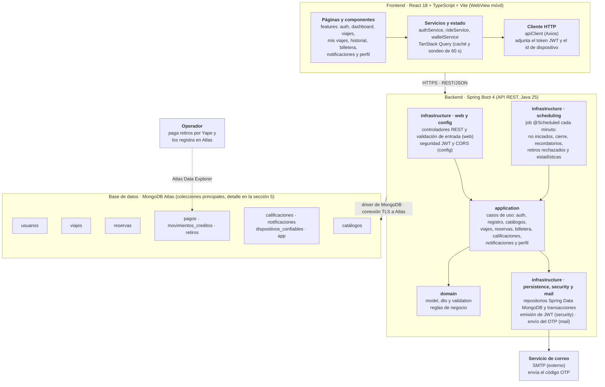

*Diagrama de componentes · 3 capas, 1 servicio externo y 1 operador manual. El frontend React consume una API REST en Spring Boot 4, que persiste en MongoDB Atlas y ejecuta su propio job programado.*

El backend se organiza por módulo, y cada módulo tiene las mismas tres capas. Cada petición entra por infrastructure: la configuración de seguridad comprueba el token y el controlador valida el formato de los datos. Luego application ejecuta el caso de uso con los modelos y reglas de domain, y persistence lee o escribe en la colección correspondiente de Atlas. El job entra por la misma capa application, así que aplica las mismas reglas que la API.

El detalle de las colecciones está en la sección 5.

### 4.1 Backend

El detalle para ejecutar, probar y extender el backend está en su propio documento, [app-movilidad-colaborativa-api/README.md](app-movilidad-colaborativa-api/README.md): variables de entorno, tokens, formato de errores, mensajes de validación por endpoint y ejemplos con curl. El contrato de la API es [docs/openapi.yaml](docs/openapi.yaml), y [docs/http/](docs/http/) tiene una solicitud de ejemplo por endpoint, con la respuesta esperada. Aquí solo va el resumen.

El backend implementa 18 de los 19 endpoints del contrato actual. Lo nuevo de este documento todavía no tiene endpoints:

| Módulo | Estado |
| --- | --- |
| Autenticación (login, OTP, cierre de sesión) | Implementado con OTP en cada login; falta el dispositivo confiable (RF-01) |
| Registro (cuenta y completar perfil) | Implementado; falta la asistencia de movilidad. La foto de perfil es opcional hasta que exista la carga de imágenes |
| Catálogos (departamentos, distritos, sedes) | Implementado; falta el campo `ciudad` de las sedes |
| Perfil (consultar y actualizar datos) | Implementado; falta el modal de cambio de modo y el resumen de saldo y calificación |
| Vehículos (registrar, consultar y actualizar) | Implementado; faltan la accesibilidad y el SOAT. La foto es opcional hasta que exista la carga de imágenes |
| Viajes y reservas (listar, publicar, detalle y reservar) | Implementado por sede; faltan el listado sin sede, una reserva activa por pasajero, la retención de créditos, Mis viajes, la cancelación, el inicio y el fin |
| Archivos (carga de imágenes) | Pendiente |
| Billetera, retiros, historial, calificaciones, notificaciones y job programado | Pendiente |

Tres decisiones definen cómo se comporta la API:

- **Validación:** el formato de los datos se valida en el DTO de la solicitud con Spring Validation, antes de llegar al servicio; las reglas que dependen del estado se quedan en la capa application.
- **Errores:** toda respuesta de error tiene la forma `{ code, message, errors?, details? }`. El cliente decide por `code`; con `VALIDATION_ERROR` el mensaje general es fijo y el detalle por campo va en `errors`.
- **Tokens:** la API es stateless con JWT. Cada token tiene un único alcance (`REGISTRATION`, `PRE_AUTH` o `SESSION`) y cada ruta exige uno, por lo que el token del login no sirve como token de sesión. El identificador de dispositivo viaja en la cabecera `X-Device-Id` del login y de la verificación del OTP.

## 5. Modelo de datos

El modelo tiene 16 colecciones en MongoDB Atlas: 15 se implementan en el alcance actual y 1 (`mensajes`, para el chat) queda definida para el próximo alcance. `usuarios` es el centro del modelo: casi todas las demás colecciones lo referencian.

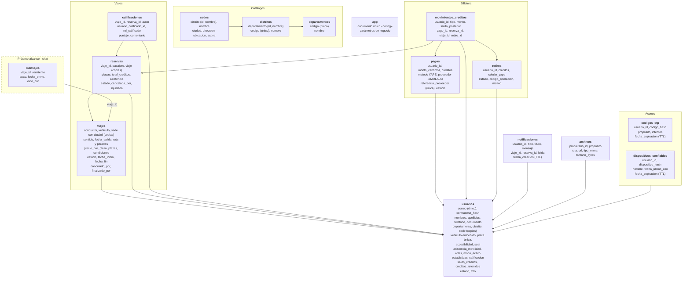

*Modelo de datos · 16 colecciones y sus referencias: 15 del alcance actual y 1 reservada para el próximo alcance. Flecha = referencia por id. Los catálogos no se consultan: `usuarios` y `viajes` copian su id, nombre y ciudad. `app` no tiene referencias.*

El modelo prioriza la lectura: cada pantalla se resuelve con un solo documento, que embebe lo que es suyo y copia el `id` y el `nombre` de lo que muestra de otras colecciones. Por eso `usuarios` no depende de los catálogos y lleva embebido su vehículo, y `viajes` lleva copiados al conductor, el vehículo y la sede. El dinero es la excepción: cada operación de créditos queda en su propio libro de movimientos (`movimientos_creditos`), y `usuarios` guarda solo el saldo resultante.

### 5.1 Colecciones del alcance actual

Son 15 colecciones: 11 de negocio, 1 de configuración (`app`) y 3 catálogos. Cada una se muestra con un documento de ejemplo. Los nombres de colecciones y campos van en español, en snake\_case y sin tildes ni ñ. En los ejemplos, `_id` y los campos `id` o terminados en `_id` son ObjectId, y las fechas son Date. Solo quedan en inglés `_id`, que lo exige MongoDB, y `type` y `coordinates` dentro de `ubicacion`, que son obligatorios en el formato GeoJSON.

**`usuarios`** — un documento por cuenta. El perfil se lee con una sola consulta: departamento, distrito y sede van copiados, y el vehículo del conductor va embebido completo.

```json
{
  "_id": "6705a1f0c3d4e5f600000002",
  "correo": "carlos.mendoza@utp.edu.pe",
  "contrasena_hash": "$2a$10$N9qo8uLOickgx2ZMRZoMye...",
  "nombres": "Carlos Alberto",
  "apellidos": "Mendoza Ruiz",
  "telefono": "+51987654321",
  "tipo_documento": "DNI",
  "numero_documento": "45678912",
  "departamento": { "id": "6705a1f0c3d4e5f600000101", "nombre": "La Libertad" },
  "distrito": { "id": "6705a1f0c3d4e5f600000201", "nombre": "Trujillo" },
  "sede": {
    "id": "6705a1f0c3d4e5f600000301",
    "nombre": "UTP Sede Trujillo",
    "ciudad": "Trujillo",
    "direccion": "Av. Nicolás de Piérola 1221, Trujillo"
  },
  "direccion_residencia": {
    "etiqueta": "Víctor Larco Herrera",
    "direccion": "Av. Larco 1250, Trujillo, La Libertad",
    "ubicacion": { "type": "Point", "coordinates": [-79.0437, -8.1321] }
  },
  "roles": ["PASAJERO", "CONDUCTOR"],
  "modo_activo": "CONDUCTOR",
  "estado": "ACTIVO",
  "asistencia_movilidad": null,
  "vehiculo": {
    "placa": "ABC-123",
    "tipo": "SEDAN",
    "marca": "Toyota",
    "modelo": "Yaris",
    "color": "Blanco",
    "anio": 2021,
    "plazas": 3,
    "dni_propietario": "45678912",
    "es_propietario": true,
    "accesibilidad": { "silla_ruedas": true, "ayuda_abordaje": false },
    "soat": {
      "aseguradora": "Rímac Seguros",
      "numero_poliza": "2401-123456",
      "fecha_inicio": "2026-03-15T05:00:00Z",
      "fecha_fin": "2027-03-15T05:00:00Z",
      "foto": { "archivo_id": "6705a1f0c3d4e5f600000904", "url": "/uploads/soat/6705a1f0c3d4e5f600000904.jpg" },
      "fecha_declaracion": "2026-10-02T10:00:00Z"
    },
    "estado": "ACTIVO",
    "foto": { "archivo_id": "6705a1f0c3d4e5f600000902", "url": "/uploads/vehiculos/6705a1f0c3d4e5f600000902.jpg" },
    "fecha_aceptacion_terminos": "2026-10-02T10:00:00Z",
    "fecha_registro": "2026-10-02T10:00:00Z"
  },
  "estadisticas": { "viajes": 342, "cumplimiento": 99, "ahorro_co2_kg": 128 },
  "calificacion": { "promedio": 4.9, "cantidad": 120 },
  "saldo_creditos": 120,
  "creditos_retenidos": 0,
  "foto": { "archivo_id": "6705a1f0c3d4e5f600000903", "url": "/uploads/perfiles/6705a1f0c3d4e5f600000903.jpg" },
  "fecha_aceptacion_terminos": "2026-10-01T15:04:00Z",
  "fecha_creacion": "2026-10-01T15:04:00Z",
  "fecha_actualizacion": "2026-10-08T09:30:00Z"
}
```

`correo` es único y se guarda en minúsculas. `roles` admite `PASAJERO` y `CONDUCTOR`; `modo_activo` es uno de los dos y solo cambia con confirmación (RN-48). `estado` es `PERFIL_PENDIENTE`, `ACTIVO` o `BLOQUEADO`. `contrasena_hash` nunca se devuelve en las respuestas de la API. `tipo_documento` es `DNI` o `CE`; junto con `numero_documento` y `telefono` queda vacío hasta que el usuario los registra en «Actualizar datos».

`vehiculo` solo existe si el usuario es conductor; no hay colección de vehículos. `vehiculo.placa` es única y se guarda en mayúsculas. `vehiculo.tipo` es `SEDAN`, `HATCHBACK`, `SUV`, `VAN` o `MOTO`, y `vehiculo.estado` es `ACTIVO` o `INACTIVO`. `vehiculo.soat` es la declaración de RN-36. `aseguradora` sale de una lista fija en el frontend (Rímac, Pacífico, La Positiva, Mapfre, Interseguro, Protecta) o es el texto de «Otra». Las fechas se guardan al inicio del día en hora de Perú.

`asistencia_movilidad` es `null` si el usuario no declaró ninguna necesidad. Si la declaró, es `{ "tipo": "SILLA_RUEDAS" | "MULETAS_ANDADOR" | "OTRA", "nota": "…", "fecha_consentimiento": Date }`, con `nota` de hasta 120 caracteres (RN-17). Es un dato sensible: nunca se copia en `viajes` ni se escribe en los logs (RN-22, RNF-13). `vehiculo.accesibilidad` guarda los dos checks de RN-18; ambos son `false` en una `MOTO`.

`saldo_creditos` es el saldo disponible y `creditos_retenidos`, lo apartado en reservas sin liquidar. Los dos son enteros ≥ 0 y solo cambian junto con un movimiento (RNF-17). `estadisticas` la recalcula el job (RN-28) y `calificacion` se recalcula con cada calificación nueva (RN-47); la API solo las lee.

**`dispositivos_confiables`** — un dispositivo desde el que el usuario ya validó un OTP (RN-35).

```json
{
  "_id": "6705a1f0c3d4e5f600000711",
  "usuario_id": "6705a1f0c3d4e5f600000002",
  "dispositivo_hash": "9f86d081884c7d659a2feaa0c55ad015a3bf4f1b2b0b822cd15d6c15b0f00a08",
  "nombre": "Android 14 · WebView",
  "fecha_ultimo_uso": "2026-10-29T08:10:00Z",
  "fecha_expiracion": "2027-01-27T08:00:00Z",
  "fecha_creacion": "2026-10-29T08:00:00Z"
}
```

`dispositivo_hash` es el SHA-256 del identificador que genera el frontend; el identificador en claro no se guarda (RNF-03). El par `usuario_id` + `dispositivo_hash` es único. El índice TTL sobre `fecha_expiracion` elimina el documento al vencer, y entonces el siguiente login vuelve a pedir OTP.

**`viajes`** — un viaje publicado. El listado del dashboard se arma solo con este documento: conductor, vehículo y sede (con su ciudad) van copiados.

```json
{
  "_id": "6705a1f0c3d4e5f600000501",
  "conductor": {
    "id": "6705a1f0c3d4e5f600000002",
    "nombre": "Carlos M.",
    "foto_url": "/uploads/perfiles/6705a1f0c3d4e5f600000903.jpg",
    "calificacion": { "promedio": 4.9, "cantidad": 120 }
  },
  "vehiculo": {
    "marca": "Toyota",
    "modelo": "Yaris",
    "color": "Blanco",
    "placa": "ABC-123",
    "apto_movilidad_reducida": true,
    "soat_fecha_fin": "2027-03-15T05:00:00Z"
  },
  "sede": { "id": "6705a1f0c3d4e5f600000301", "nombre": "UTP Sede Trujillo", "ciudad": "Trujillo" },
  "sentido": "REGRESO_CASA",
  "origen": {
    "etiqueta": "Universidad Tecnológica del Perú",
    "direccion": "Sede Trujillo, Av. Nicolás de Piérola",
    "ubicacion": { "type": "Point", "coordinates": [-79.0353, -8.0975] }
  },
  "destino": {
    "etiqueta": "Huaca del Dragón (Arco Iris)",
    "direccion": "La Esperanza, Trujillo",
    "ubicacion": { "type": "Point", "coordinates": [-79.0412, -8.0716] }
  },
  "paradas": [
    { "etiqueta": "Óvalo Papal", "ubicacion": { "type": "Point", "coordinates": [-79.0389, -8.0851] } }
  ],
  "distancia_km": 8.5,
  "duracion_min": 15,
  "fecha_salida": "2026-10-09T13:30:00Z",
  "precio_por_plaza": 5,
  "plazas_totales": 3,
  "plazas_disponibles": 2,
  "condiciones": ["No se admite desvíos", "Máximo de espera 5 minutos", "No gritar"],
  "estado": "EN_CURSO",
  "fecha_inicio": "2026-10-09T13:32:00Z",
  "fecha_fin": null,
  "finalizado_por": null,
  "recordatorio_enviado": true,
  "fecha_cancelacion": null,
  "cancelado_por": null,
  "motivo_cancelacion": null,
  "fecha_creacion": "2026-10-08T20:00:00Z",
  "fecha_actualizacion": "2026-10-09T13:32:00Z"
}
```

`sentido` es `IDA_UNIVERSIDAD` o `REGRESO_CASA`. `precio_por_plaza` está en créditos, entre 1 y 10 (RN-13). `plazas_disponibles` se descuenta de forma atómica al reservar y se devuelve al cancelar. `estado` es `PUBLICADO`, `EN_CURSO`, `COMPLETADO` o `CANCELADO` (sección 2.3). `cancelado_por` es `CONDUCTOR` o `SISTEMA`, y `finalizado_por` es `CONDUCTOR` o `SISTEMA`. `motivo_cancelacion` es opcional y tiene hasta 200 caracteres. `sede.ciudad` es la etiqueta del dashboard (RN-49). `vehiculo.apto_movilidad_reducida` alimenta el filtro de RN-19, y `vehiculo.soat_fecha_fin` permite mostrar la leyenda de RN-36 sin leer el perfil del conductor. `recordatorio_enviado` lo marca el job (RN-33).

`paradas` admite un máximo de 5 elementos y `condiciones` un máximo de 10. Las copias de `conductor` y `vehiculo` solo se actualizan en los viajes activos (`PUBLICADO` o `EN_CURSO`). En los viajes terminados o cancelados quedan como registro histórico.

En este alcance `distancia_km` es la distancia en línea recta entre origen, paradas y destino, y `duracion_min` una estimación a partir de ella, a una velocidad media de 35 km/h. Cuando se integre un servicio de rutas, los mismos campos guardarán los valores reales por calles.

**`reservas`** — la reserva de un pasajero. Copia lo necesario del viaje para mostrar Mis viajes y el historial sin consultar `viajes`.

```json
{
  "_id": "6705a1f0c3d4e5f600000601",
  "viaje_id": "6705a1f0c3d4e5f600000501",
  "conductor_id": "6705a1f0c3d4e5f600000002",
  "pasajero": {
    "id": "6705a1f0c3d4e5f600000001",
    "nombre": "Valeria R.",
    "calificacion": { "promedio": 4.7, "cantidad": 15 }
  },
  "viaje": {
    "origen": "UTP Sede Trujillo",
    "destino": "Huaca del Dragón",
    "ciudad": "Trujillo",
    "fecha_salida": "2026-10-09T13:30:00Z",
    "conductor": "Carlos M.",
    "vehiculo": { "marca": "Toyota", "modelo": "Yaris", "color": "Blanco" }
  },
  "plazas": 1,
  "total_creditos": 5,
  "asistencia": { "tipo": "SILLA_RUEDAS", "nota": "Silla plegable, puedo pasar al asiento solo." },
  "estado": "EN_VIAJE",
  "liquidada": false,
  "cancelada_por": null,
  "fecha_cancelacion": null,
  "fecha_creacion": "2026-10-08T21:15:00Z",
  "fecha_actualizacion": "2026-10-09T13:32:00Z"
}
```

`estado` es `CONFIRMADA`, `EN_VIAJE`, `COMPLETADA`, `NO_SE_PRESENTO` o `CANCELADA`. Un pasajero tiene como máximo una reserva activa (`CONFIRMADA` o `EN_VIAJE`) en total (RN-23). `cancelada_por` es `PASAJERO`, `CONDUCTOR` o `SISTEMA`. `liquidada` pasa a `true` cuando sus créditos se reembolsan o se pagan al conductor (RN-40), y evita liquidar dos veces. La copia de `viaje` es una foto del momento de la reserva y no se actualiza. `asistencia` es la copia de `usuarios.asistencia_movilidad` al reservar, sin `fecha_consentimiento`, o `null` (RN-21). `conductor_id` permite listar los pasajeros de un conductor sin consultar `viajes`.

**`calificaciones`** — una calificación entre participantes de un viaje completado (RN-47).

```json
{
  "_id": "6705a1f0c3d4e5f600000a01",
  "viaje_id": "6705a1f0c3d4e5f600000501",
  "reserva_id": "6705a1f0c3d4e5f600000601",
  "autor": { "id": "6705a1f0c3d4e5f600000001", "nombre": "Valeria R." },
  "usuario_calificado_id": "6705a1f0c3d4e5f600000002",
  "rol_calificado": "CONDUCTOR",
  "puntaje": 5,
  "comentario": "Puntual y amable.",
  "fecha_creacion": "2026-10-09T14:00:00Z"
}
```

`puntaje` es un entero de 1 a 5 y `comentario` tiene hasta 200 caracteres. El trío `reserva_id` + `autor.id` + `usuario_calificado_id` es único. Insertar la calificación y recalcular `usuarios.calificacion` del calificado se hacen en una misma transacción. Después se actualiza la copia en sus viajes activos.

**`pagos`** — recarga de créditos. En este alcance es simulada (RN-41).

```json
{
  "_id": "6705a1f0c3d4e5f600000801",
  "usuario_id": "6705a1f0c3d4e5f600000001",
  "monto_centimos": 2000,
  "creditos": 20,
  "creditos_por_sol": 1,
  "metodo": "YAPE",
  "proveedor": "SIMULADO",
  "referencia_proveedor": "08451236",
  "estado": "APROBADO",
  "fecha_creacion": "2026-10-08T18:00:00Z"
}
```

`monto_centimos` guarda el dinero como entero en céntimos de sol (2000 = S/ 20.00), nunca como decimal de punto flotante. `creditos_por_sol` guarda la tasa vigente al momento de la recarga. `referencia_proveedor` es el código de operación de Yape, único para no registrar dos veces la misma operación. `estado` admite `PENDIENTE`, `APROBADO` y `RECHAZADO` para cuando se integre una pasarela real; hoy siempre es `APROBADO`. `proveedor = SIMULADO` permite separar estas recargas de las reales cuando existan.

**`movimientos_creditos`** — libro de movimientos de créditos. Solo se insertan documentos; `usuarios.saldo_creditos` es la suma de los movimientos del usuario.

```json
{
  "_id": "6705a1f0c3d4e5f600000811",
  "usuario_id": "6705a1f0c3d4e5f600000001",
  "tipo": "RETENCION_RESERVA",
  "monto": -5,
  "saldo_posterior": 15,
  "descripcion": "Reserva: UTP Sede Trujillo → Huaca del Dragón",
  "pago_id": null,
  "reserva_id": "6705a1f0c3d4e5f600000601",
  "viaje_id": "6705a1f0c3d4e5f600000501",
  "retiro_id": null,
  "fecha_creacion": "2026-10-08T21:15:00Z"
}
```

| `tipo` | Signo | A quién | Cuándo |
| --- | --- | --- | --- |
| `RECARGA` | + | Usuario | Recarga simulada (RF-11) |
| `RETENCION_RESERVA` | − | Pasajero | Reserva creada; también suma a `creditos_retenidos` (RF-04) |
| `REEMBOLSO` | + | Pasajero | Reserva cancelada por cualquiera; también resta de `creditos_retenidos` (RF-06, RF-08) |
| `COBRO_VIAJE` | + | Conductor | Cierre del viaje: una por reserva `COMPLETADA` o `NO_SE_PRESENTO`. Al pasajero solo se le resta de `creditos_retenidos` (RN-40) |
| `RETIRO` | − | Conductor | Retiro solicitado (RF-12) |
| `REVERSION_RETIRO` | + | Conductor | Retiro rechazado por el operador (RF-12) |

Insertar el movimiento y actualizar los saldos de `usuarios` se ejecutan en una misma transacción. Cada movimiento referencia su origen (`pago_id`, `reserva_id`, `viaje_id` o `retiro_id`), lo que permite la conciliación de RNF-17.

**`retiros`** — solicitud de retiro de créditos de un conductor (RF-12).

```json
{
  "_id": "6705a1f0c3d4e5f600000821",
  "usuario_id": "6705a1f0c3d4e5f600000002",
  "creditos": 50,
  "celular_yape": "987654321",
  "estado": "PAGADO",
  "codigo_operacion": "12345678",
  "motivo_rechazo": null,
  "reversion_aplicada": false,
  "fecha_solicitud": "2026-10-10T09:00:00Z",
  "fecha_resolucion": "2026-10-10T18:30:00Z"
}
```

`estado` es `PENDIENTE`, `PAGADO` o `RECHAZADO`. El operador cambia el estado en Atlas y completa `codigo_operacion` (al pagar) o `motivo_rechazo` (al rechazar), además de `fecha_resolucion`. Cuando un retiro está `RECHAZADO` con `reversion_aplicada = false`, el job inserta el movimiento `REVERSION_RETIRO`, notifica al conductor y marca `reversion_aplicada = true` (RN-42). Hay como máximo un retiro `PENDIENTE` por usuario.

**`codigos_otp`** — código de verificación de un solo uso.

```json
{
  "_id": "6705a1f0c3d4e5f600000701",
  "usuario_id": "6705a1f0c3d4e5f600000001",
  "codigo_hash": "$2a$10$7EqJtq98hPqEX7fNZaFWoO...",
  "proposito": "INICIO_SESION",
  "intentos": 0,
  "fecha_expiracion": "2026-10-08T21:05:00Z",
  "fecha_creacion": "2026-10-08T21:00:00Z"
}
```

`fecha_expiracion` tiene un índice TTL: MongoDB elimina el documento al expirar. `intentos` llega como máximo a 3. `proposito` es `INICIO_SESION`; `RECUPERAR_CONTRASENA` queda reservado para la recuperación de contraseña. En este alcance solo se crea un código cuando el dispositivo no es confiable (RN-35).

**`archivos`** — imagen cargada. El archivo se guarda en un directorio del servidor del backend y se expone por URL. El frontend la sube con `POST /api/files` (JPG o PNG de hasta 5 MB) y envía el `id` que recibe en el formulario de perfil, vehículo o SOAT.

```json
{
  "_id": "6705a1f0c3d4e5f600000903",
  "propietario_id": "6705a1f0c3d4e5f600000002",
  "proposito": "FOTO_PERFIL",
  "ruta": "perfiles/6705a1f0c3d4e5f600000903.jpg",
  "url": "/uploads/perfiles/6705a1f0c3d4e5f600000903.jpg",
  "tipo_mime": "image/jpeg",
  "tamano_bytes": 184320,
  "fecha_creacion": "2026-10-01T15:10:00Z"
}
```

`proposito` es `FOTO_PERFIL`, `FOTO_VEHICULO` o `FOTO_SOAT`. La `url` se copia en `usuarios.foto`, `usuarios.vehiculo.foto` o `usuarios.vehiculo.soat.foto`. La foto de perfil y la del SOAT son obligatorias (RN-04, RN-14, RN-36). La del vehículo es opcional en el registro y obligatoria al actualizarlo (RN-06, RN-15). La foto del SOAT solo la ve su dueño.

**`notificaciones`** — bandeja de avisos de un usuario (RF-13). La app nativa la reutilizará para enviar push.

```json
{
  "_id": "6705a1f0c3d4e5f600000c01",
  "usuario_id": "6705a1f0c3d4e5f600000002",
  "tipo": "NUEVA_RESERVA",
  "titulo": "Nueva reserva",
  "mensaje": "Valeria R. reservó 1 plaza(s) en tu viaje del 09/10 08:30. Necesita asistencia: Silla de ruedas.",
  "viaje_id": "6705a1f0c3d4e5f600000501",
  "reserva_id": "6705a1f0c3d4e5f600000601",
  "leida": false,
  "fecha_creacion": "2026-10-08T21:15:00Z"
}
```

`tipo` es `NUEVA_RESERVA`, `RESERVA_CANCELADA`, `VIAJE_CANCELADO`, `RECORDATORIO_SALIDA`, `VIAJE_INICIADO`, `NO_SE_PRESENTO`, `VIAJE_COMPLETADO` o `RETIRO_RECHAZADO` (tabla de RF-13). `mensaje` se guarda ya armado, con los datos del momento del evento, y no se actualiza. Un índice TTL sobre `fecha_creacion` borra la notificación a los 30 días (RN-34). El texto de asistencia solo aparece en notificaciones para el conductor del viaje (RN-22).

**`app`** — un único documento con los parámetros de negocio configurables (RN-31). Se edita directamente en la base de datos.

```json
{
  "_id": "config",
  "max_cancelaciones_conductor": 10,
  "max_cancelaciones_pasajero": 5,
  "ventana_cancelaciones_dias": 30,
  "minutos_limite_cancelacion": 30,
  "minutos_inicio_anticipado": 15,
  "minutos_tolerancia_inicio": 30,
  "minutos_cierre_automatico": 15,
  "minutos_recordatorio": 30,
  "dias_dispositivo_confiable": 90,
  "dias_para_calificar": 7,
  "recarga_minima": 5,
  "recarga_maxima": 200,
  "retiro_minimo": 10,
  "factor_co2_kg_km": 0.18,
  "fecha_actualizacion": "2026-10-29T10:00:00Z"
}
```

El backend lee este documento en cada operación que usa un parámetro, sin caché, así que un cambio rige desde la siguiente operación. Si falta un campo, usa el valor por defecto del ejemplo.

**Catálogos** — `departamentos`, `distritos` y `sedes` alimentan los formularios. Los demás documentos copian su `id` y `nombre`, y de la sede también su `ciudad`.

```json
{ "_id": "6705a1f0c3d4e5f600000101", "codigo": "13", "nombre": "La Libertad" }
```

```json
{
  "_id": "6705a1f0c3d4e5f600000201",
  "codigo": "130101",
  "nombre": "Trujillo",
  "departamento": { "id": "6705a1f0c3d4e5f600000101", "nombre": "La Libertad" }
}
```

```json
{
  "_id": "6705a1f0c3d4e5f600000301",
  "nombre": "UTP Sede Trujillo",
  "ciudad": "Trujillo",
  "institucion": "Universidad Tecnológica del Perú",
  "direccion": "Av. Nicolás de Piérola 1221, Trujillo",
  "distrito": { "id": "6705a1f0c3d4e5f600000201", "nombre": "Trujillo" },
  "ubicacion": { "type": "Point", "coordinates": [-79.0353, -8.0975] },
  "activa": true
}
```

`codigo` es el ubigeo y es único en `departamentos` y `distritos`. `ciudad` es la etiqueta corta que ve el pasajero (RN-49). En Lima agrupa varias sedes por zona: «Lima Centro», «Lima Norte», «Lima Sur» y «Lima Este»; en provincias es el nombre de la ciudad, por ejemplo «Trujillo», «Arequipa», «Chiclayo» o «Piura».

### 5.2 Colecciones del próximo alcance

Queda una colección que no se implementa todavía, pero el modelo ya la contempla para no reestructurar los datos después.

**`mensajes`** — chat entre el conductor y los pasajeros de un viaje.

```json
{
  "_id": "6705a1f0c3d4e5f600000b01",
  "viaje_id": "6705a1f0c3d4e5f600000501",
  "remitente": { "id": "6705a1f0c3d4e5f600000001", "nombre": "Valeria R." },
  "texto": "Ya estoy en la puerta principal.",
  "fecha_envio": "2026-10-09T13:25:00Z",
  "leido_por": ["6705a1f0c3d4e5f600000002"]
}
```

### 5.3 Decisiones de diseño e índices

La regla es modelar según cómo se lee: se embebe o se copia lo que una pantalla muestra junto, y solo se referencia por id lo que tiene vida propia o crece sin límite.

| Decisión | Motivo |
| --- | --- |
| El vehículo, su accesibilidad y su SOAT van embebidos en `usuarios`; no hay colección de vehículos. | Es una relación 1 a 1 que siempre se lee con el perfil. Embebido no hay datos duplicados ni escrituras en dos colecciones. |
| `usuarios` copia `id` y `nombre` de departamento, distrito y sede, y de la sede también `ciudad`. | El perfil es la lectura prioritaria y se resuelve sin consultar los catálogos. Los nombres de catálogo casi nunca cambian; si cambian, se actualizan las copias. |
| `viajes` copia los datos del conductor, el vehículo y la sede con su ciudad. | El listado del dashboard (de todas las sedes) y el detalle del viaje salen de un solo documento. Solo se actualizan las copias de los viajes activos, que son pocos por conductor. |
| `reservas` copia un resumen del viaje y del pasajero. | Mis viajes y el historial del pasajero se listan sin consultar `viajes`. Es una foto histórica: no se actualiza. |
| El saldo se guarda en `usuarios` y cada cambio, en `movimientos_creditos`. | Leer el saldo es una sola consulta, y el libro de solo inserción permite auditarlo y reconstruirlo (RNF-17). |
| La retención se modela con `creditos_retenidos` y el flag `reservas.liquidada`, no con una colección aparte. | Cada reserva retiene una sola vez y se liquida una sola vez. El flag hace idempotente la liquidación del job. |
| Los retiros se resuelven editando `retiros` en Atlas, y el job aplica la reversión. | No hay administrador en este alcance. El operador solo cambia el estado, y la lógica de dinero queda en el backend. |
| El dispositivo confiable se guarda en `dispositivos_confiables`, con TTL. | Un usuario tiene varios dispositivos, cada uno con su propio vencimiento, y la base los borra sola. |
| Los procesos programados son un job `@Scheduled` del backend. | El tier de Atlas del proyecto no admite Scheduled Triggers. Para no depender de una sola instancia (RNF-10), cada cambio es un update condicionado al estado actual, y las estadísticas se recalculan en lugar de sumarse: si dos instancias corren el job a la vez, el resultado es el mismo. |
| Los parámetros de negocio viven en la colección `app` y no en `application.yml`. | Se pueden cambiar sin desplegar de nuevo el backend (RN-31). |
| `notificaciones` es una colección aparte, con `mensaje` ya armado. | Crece sin límite, se lee por usuario y caduca sola con TTL. Guardar el texto final evita reconstruirlo y conserva lo que se avisó en ese momento. |
| `direccion_residencia`, `estadisticas`, `calificacion`, `origen`, `destino`, `paradas` y `condiciones` van embebidos. | Son pocos datos, no se consultan por separado y pertenecen a un solo documento. Los dos arreglos tienen límite. |
| `reservas` y `calificaciones` son colecciones aparte de `viajes`. | Crecen sin límite conocido y se consultan por pasajero o por calificado. |
| Las imágenes no se guardan en MongoDB. | El archivo vive en el servidor; la base solo guarda la ruta y la URL en `archivos`. |

Cada índice responde a una consulta concreta.

| Colección | Índice | Uso |
| --- | --- | --- |
| `usuarios` | `correo` único | Login y validación de correo duplicado. |
| `usuarios` | `vehiculo.placa` único parcial (solo usuarios con vehículo) | Placa irrepetible entre conductores. |
| `dispositivos_confiables` | `usuario_id` + `dispositivo_hash` único | Saber si el dispositivo es confiable en el login (RN-35). |
| `dispositivos_confiables` | `fecha_expiracion` TTL | Vencimiento automático de la confianza. |
| `viajes` | `estado` + `fecha_salida` | Listado del dashboard de todas las sedes y tareas del job (RF-03, RF-08). |
| `viajes` | `conductor.id` + `estado` | Mis viajes del conductor, un solo viaje en curso y actualización de copias. |
| `viajes` | `conductor.id` + `estado` + `fecha_cancelacion` | Cancelaciones recientes del conductor (RN-30). |
| `viajes` | `conductor.id` + `fecha_salida` (descendente) | Historial del conductor (RF-09). |
| `reservas` | `pasajero.id` único parcial (solo `CONFIRMADA` y `EN_VIAJE`) | Una sola reserva activa por pasajero (RN-23). |
| `reservas` | `viaje_id` + `estado` | Pasajeros de un viaje al iniciar, cerrar o cancelar. |
| `reservas` | `pasajero.id` + `viaje.fecha_salida` (descendente) | Mis viajes e historial del pasajero (RF-06, RF-09). |
| `reservas` | `pasajero.id` + `cancelada_por` + `fecha_cancelacion` | Cancelaciones recientes del pasajero (RN-38). |
| `calificaciones` | `reserva_id` + `autor.id` + `usuario_calificado_id` único | Una calificación por autor y calificado en cada viaje (RN-47). |
| `calificaciones` | `usuario_calificado_id` | Recalcular el promedio del calificado. |
| `pagos` | `referencia_proveedor` único | Evita registrar dos veces el mismo código de operación (RN-41). |
| `movimientos_creditos` | `usuario_id` + `fecha_creacion` (descendente) | Movimientos de la billetera y conciliación. |
| `retiros` | `usuario_id` único parcial (solo `PENDIENTE`) | Un solo retiro pendiente por usuario (RN-42). |
| `retiros` | `estado` + `reversion_aplicada` | Retiros rechazados por revertir en el job. |
| `notificaciones` | `usuario_id` + `leida` + `fecha_creacion` | Bandeja y contador de no leídas (RF-13). |
| `notificaciones` | `fecha_creacion` TTL (30 días) | Expiración automática (RN-34). |
| `codigos_otp` | `fecha_expiracion` TTL | Expiración automática del código. |
| `codigos_otp` | `usuario_id` | Búsqueda del código vigente. |
| `distritos` | `departamento.id` | Distritos de un departamento en los formularios. |

El índice parcial de `reservas` filtra con `estado: { $in: ["CONFIRMADA", "EN_VIAJE"] }`, que MongoDB admite en índices parciales desde la versión 6.0. Un índice geoespacial para buscar viajes por cercanía queda para cuando exista esa búsqueda (sección 1.1).

### 5.4 Validación de antipatrones

El modelo se revisó contra 12 antipatrones de modelado en MongoDB: 9 tenían hallazgos y quedaron corregidos, y 3 no tenían hallazgos.

| Antipatrón | Resultado | Qué se encontró y cómo quedó |
| --- | --- | --- |
| Separar datos que siempre se leen juntos | Corregido | `vehiculos` era una colección 1 a 1 con `usuarios`. Ahora el vehículo, con su SOAT, va embebido en `usuarios.vehiculo`. |
| Datos duplicados sin regla de actualización | Corregido | Cada copia tiene regla: las de `viajes` se actualizan solo en viajes activos, y las de `reservas` y `notificaciones` son históricas. |
| Arreglos sin límite | Corregido | `paradas` y `condiciones` no tenían tope. Ahora admiten 5 y 10 elementos. Las calificaciones y los movimientos, que crecen sin límite, son colecciones aparte. |
| Índices innecesarios | Corregido | Había índices geoespaciales sin una consulta que los use. Se retiraron hasta que exista la búsqueda por cercanía. |
| Índice único mal definido | Corregido | El índice único de `reservas` impedía volver a reservar tras cancelar. Ahora es parcial, sobre las reservas activas, igual que el de la placa y el del retiro pendiente. |
| Búsquedas que no distinguen mayúsculas sin soporte de índice | Corregido | `correo` y `placa` podían duplicarse por diferencias de mayúsculas. Se guardan normalizados: correo en minúsculas y placa en mayúsculas. |
| Dinero en punto flotante | Corregido | `monto_soles` era un decimal. Ahora es `monto_centimos`, un entero; los créditos ya eran enteros. |
| Escrituras relacionadas sin atomicidad | Corregido | Reserva, plaza, retención y notificación; cierre del viaje y liquidación; y movimiento y saldo se ejecutan en transacciones. |
| Texto de presentación guardado como dato | Corregido | `reservas.viaje.ruta` guardaba «A → B» en una sola cadena. Ahora son los campos `origen` y `destino`. El `mensaje` de las notificaciones es la excepción deliberada: conserva lo que se avisó. |
| Documentos inflados | Sin hallazgos | Ningún documento supera unos pocos KB. `contrasena_hash` se excluye de las respuestas. |
| Demasiadas colecciones | Sin hallazgos | Son 16 colecciones, cada una con un patrón de acceso propio. |
| Datos temporales sin expiración | Sin hallazgos | `codigos_otp`, `dispositivos_confiables` y `notificaciones` se eliminan solas con índices TTL. |

Riesgo aceptado: `viajes` copia la calificación del conductor y `reservas` la del pasajero, y cambian con cada calificación nueva. Se mantiene porque la tarjeta del dashboard y Mis viajes las muestran, y el costo es bajo: solo se actualizan los viajes activos del calificado y sus reservas activas.

## 6. Secuencia: inicio de sesión

El login valida las credenciales y, solo si el dispositivo no es confiable, pide el código OTP (RF-01, RN-35). Desde un dispositivo confiable, el login entrega directamente el token `SESSION`. Desde uno nuevo, entrega un token `PRE_AUTH`, que solo sirve para verificar o reenviar el código, y la verificación entrega `SESSION` (sección 4.1).

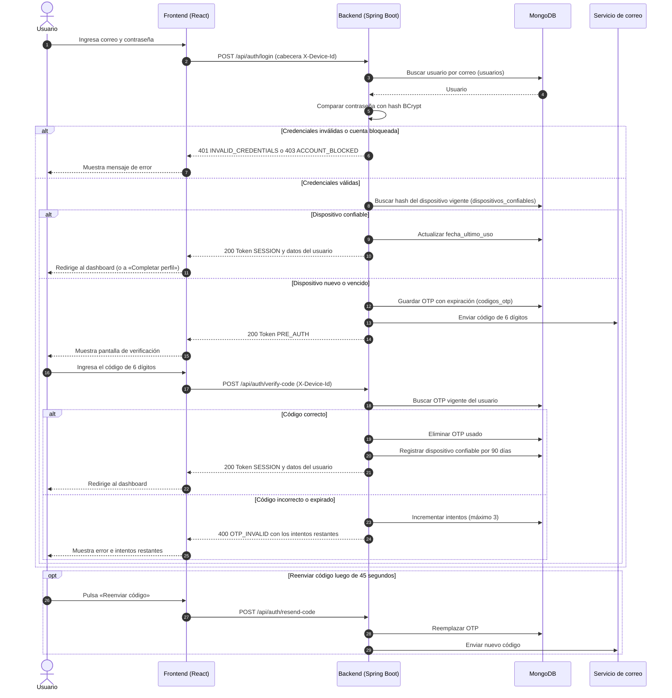

## 7. Secuencia: registro

Pasajeros y conductores comparten el mismo registro en tres pasos. La casilla «Tengo vehículo» decide si el flujo termina en el perfil (pasajero) o continúa con el vehículo y su SOAT (conductor) (RF-02, casuísticas A a E).

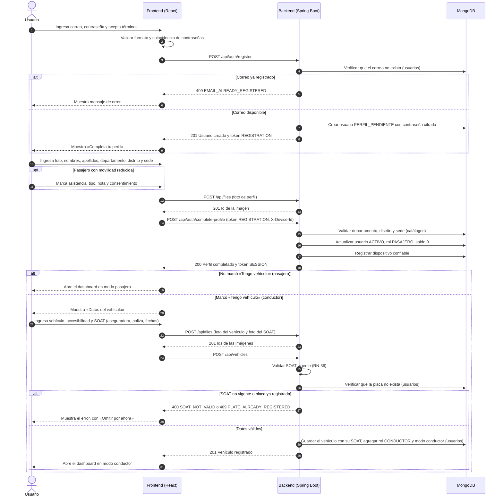

## 8. Secuencias de viajes

El dashboard es el punto de partida de los procesos centrales: el conductor publica un viaje, el pasajero lo reserva con créditos, el conductor lo inicia y lo finaliza, y ambos se califican. Todas las peticiones de esta sección llevan el token JWT de la sesión.

### 8.1 Publicación de un viaje (conductor)

El viaje solo se guarda después de que el conductor confirma el resumen, y queda visible de inmediato para los pasajeros de todas las sedes (RF-05).

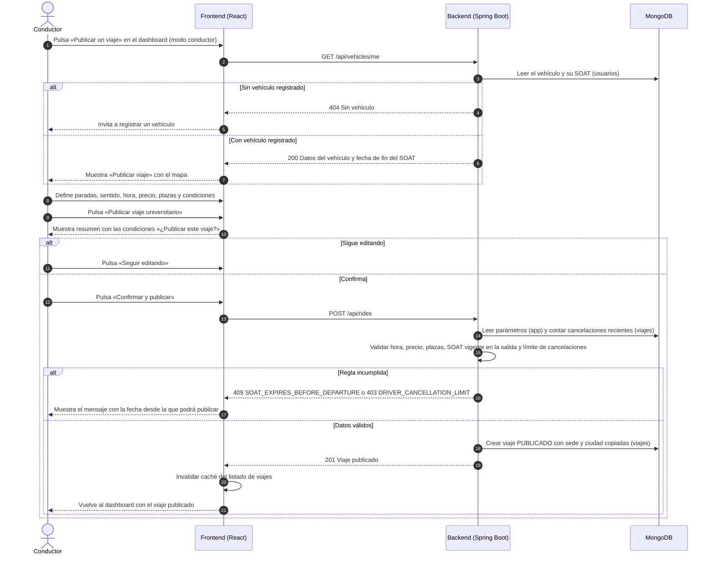

### 8.2 Reserva de un viaje (pasajero)

La reserva se confirma en un modal, desde la tarjeta del dashboard o desde el detalle del viaje. En una sola transacción, el backend descuenta la plaza, retiene los créditos y avisa al conductor (RF-03, RF-04).

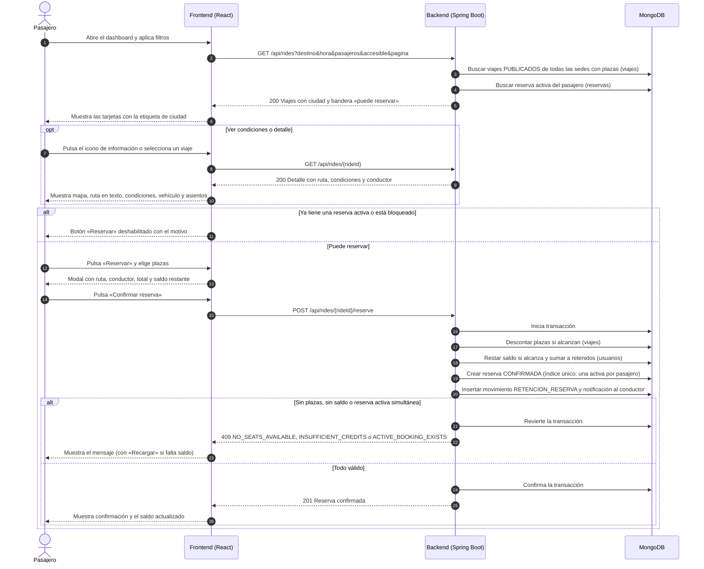

### 8.3 Ejecución y cierre del viaje

El conductor inicia el viaje marcando a los presentes y lo finaliza al llegar. Si no lo inicia o no lo finaliza, el job lo cancela o lo cierra solo, y en ambos casos los créditos se liquidan en la misma transacción (RF-06, RF-07, RF-08).

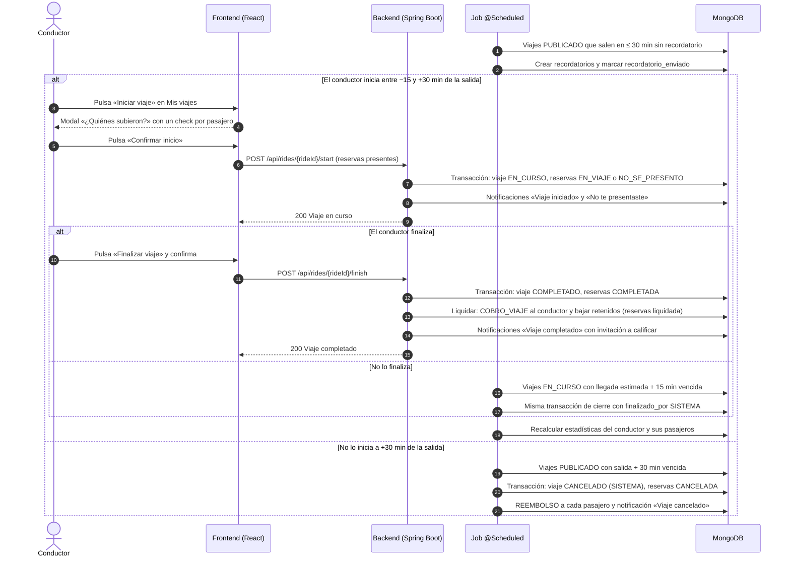

### 8.4 Calificación

Después del cierre, cada participante puede calificar durante 7 días, desde la notificación o desde el historial (RF-09, RF-10).

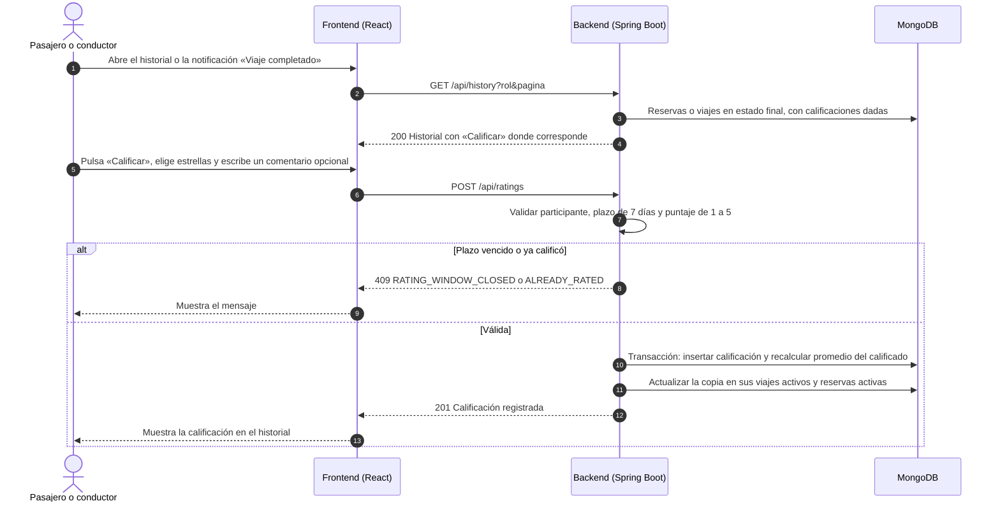

## 9. Secuencias: perfil y billetera

### 9.1 Perfil, vehículo y cambio de modo

El perfil se carga con un solo documento, que ya incluye el vehículo, el SOAT, el saldo y la calificación. Desde ahí se actualizan los datos personales y los del vehículo, y se cambia de modo con confirmación (RF-14).

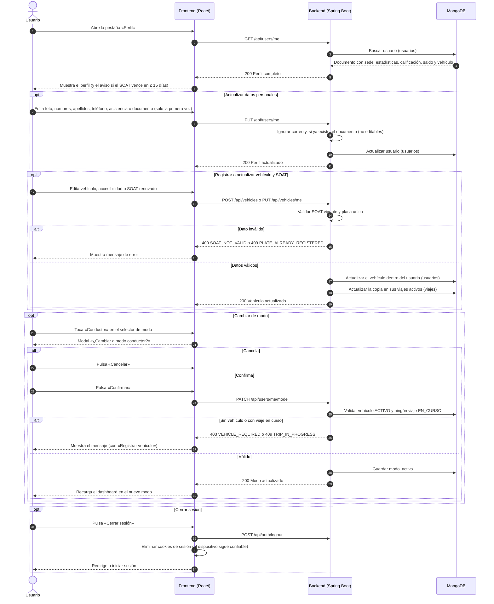

### 9.2 Billetera: recarga y retiro

La recarga simulada acredita al instante. El retiro descuenta al solicitarlo y lo resuelve un operador en la base de datos (RF-11, RF-12).

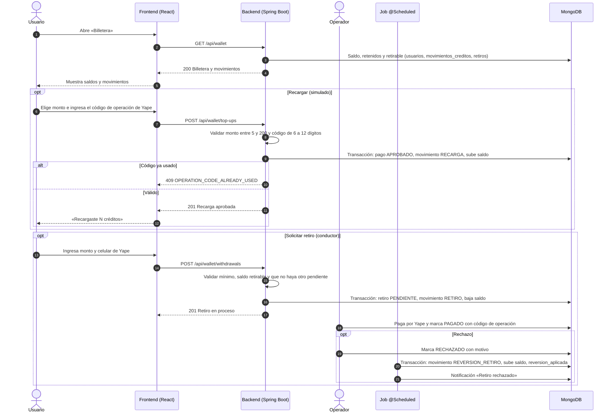

## 10. Plan de trabajo

El plan propone 11 fases en 16 semanas. Primero se levantó el backend para las pantallas que ya existían; después se construye cada módulo nuevo de extremo a extremo. Las semanas son una propuesta y no tienen fechas asignadas.

| Fase | Semanas | Alcance | RF | Entregable |
| --- | --- | --- | --- | --- |
| 1. Base del backend | 1 | Proyecto Spring Boot 4 con los paquetes application, domain e infrastructure, clúster en MongoDB Atlas y seguridad con JWT. | — | API desplegable con endpoint de salud, conectada al clúster de Atlas con las colecciones creadas. |
| 2. Autenticación y registro | 2 | Endpoints de login, OTP, registro, completar perfil y carga de imágenes; el frontend deja de usar MSW en estos flujos. | RF-01, RF-02 | Login y registro funcionando contra la API real. |
| 3. Vehículo | 3 | Pantalla «Datos del vehículo» y endpoint de registro de vehículos. | RF-02 | Registro completo de conductores. |
| 4. Viajes y reserva | 4 y 5 | Listado con filtros, condiciones, detalle con mapa (Leaflet) y reserva con confirmación. | RF-03, RF-04 | Un pasajero reserva un viaje publicado. |
| 5. Publicación | 6 | Pantalla «Publicar viaje» con mapa (Leaflet), confirmación y endpoint de creación de viajes. | RF-05 | Un conductor publica un viaje visible en el dashboard. |
| 6. Perfil y cierre | 7 y 8 | Perfil de pasajero y conductor, actualización de datos y vehículo, cierre de sesión, pruebas y documentación. | RF-01, RF-14 | Versión con pruebas de los flujos principales. |
| 7. Accesos y registro v3 | 9 | Dispositivo confiable, asistencia de movilidad, accesibilidad y SOAT del vehículo, campo `ciudad` en sedes, colección `app` y modal de cambio de modo. | RF-01, RF-02, RF-14 | Un usuario vuelve a entrar sin OTP desde su dispositivo, y un conductor registra su SOAT. |
| 8. Billetera | 10 y 11 | Recarga simulada con Yape, libro de movimientos, retiros y script de conciliación. | RF-11, RF-12 | Un pasajero recarga y un conductor solicita un retiro que el operador paga. |
| 9. Reserva y Mis viajes | 12 y 13 | Listado de todas las sedes, una reserva activa, retención de créditos, Mis viajes (17), cancelaciones con límites y bandeja de notificaciones (18). | RF-03, RF-04, RF-05, RF-06, RF-13 | Un pasajero reserva con créditos y cancela con reembolso; el conductor recibe los avisos. |
| 10. Ejecución del viaje | 14 | Iniciar con presentes, finalizar, job `@Scheduled` (no iniciados, cierre, recordatorios, reversión de retiros y estadísticas) y liquidación. | RF-07, RF-08 | Un viaje completo, desde la reserva hasta el cobro del conductor, también cuando lo cierra el job. |
| 11. Historial, calificaciones y auditoría | 15 y 16 | Historial (19), calificaciones (20), auditoría WCAG 2.1 AA, prueba de carga y pruebas de concurrencia. | RF-09, RF-10 | Pasajero y conductor se califican; la app pasa las verificaciones de la sección 3. |

Avance: la fase 1 está completa, salvo el endpoint de salud. De la fase 2, el backend ya tiene login, OTP, registro, completar perfil y catálogos; falta la carga de imágenes (`POST /files`). El backend también tiene los endpoints de las fases 3 a 6: vehículos, viajes, reservas y perfil. El frontend ya se conecta al backend real (`npm run dev:api`), conserva la API simulada con MSW para desarrollar sin él y cubre las fases 3 a 6: datos del vehículo, reserva con confirmación, publicación, perfil y actualización de datos y vehículo. Las fases 7 a 11 no se han iniciado.

Estado del frontend: las 16 pantallas de `frames/` están implementadas. Quedan por conectar los filtros del dashboard con `GET /rides` y la carga de fotos, que depende de `POST /files` en el backend.

## 11. Pantallas de referencia (`frames/`)

Los 16 mockups de `frames/` guían la implementación visual y son los que referencia la columna Pantalla de la sección 2. Las pantallas 17 a 21 todavía no tienen mockup. La columna Estado indica si el frontend (`app-utp-movilidad-colaborativa/`) ya implementa la pantalla. La UI está adaptada a **WebView** (sin marco móvil, safe areas, `100dvh`).

| # | Archivo | Pantalla | Módulo | Estado |
| --- | --- | --- | --- | --- |
| 01 | [01. login.jpeg](<frames/01. login.jpeg>) | Iniciar sesión | Autenticación | Implementada |
| 02 | [02. login_verificacion.jpeg](<frames/02. login_verificacion.jpeg>) | Verificación OTP | Autenticación | Implementada |
| 03 | [03. registro.jpeg](<frames/03. registro.jpeg>) | Registro | Registro | Implementada |
| 04 | [04. registro_datos_personales.jpeg](<frames/04. registro_datos_personales.jpeg>) | Completar perfil | Registro | Implementada |
| 05 | [05. registro_vehiculo.jpeg](<frames/05. registro_vehiculo.jpeg>) | Datos del vehículo | Registro | Implementada (sin SOAT) |
| 06 | [06. dashboard.jpeg](<frames/06. dashboard.jpeg>) | Dashboard / viajes | Viajes | Implementada |
| 07 | [07. dashboard_condiciones_viaje.jpeg](<frames/07. dashboard_condiciones_viaje.jpeg>) | Condiciones del viaje | Viajes | Implementada |
| 08 | [08. dashboard_confirm_viaje.jpeg](<frames/08. dashboard_confirm_viaje.jpeg>) | Confirmar reserva (dashboard) | Viajes | Implementada |
| 09 | [09. dashboard_detalle_viaje.jpeg](<frames/09. dashboard_detalle_viaje.jpeg>) | Detalle del viaje | Viajes | Implementada |
| 10 | [10. confirm_detalle_viaje.jpeg](<frames/10. confirm_detalle_viaje.jpeg>) | Confirmar reserva (detalle) | Viajes | Implementada |
| 11 | [11. publicar_viaje.jpeg](<frames/11. publicar_viaje.jpeg>) | Publicar viaje | Viajes | Implementada |
| 12 | [12. confirm_publicar_viaje.jpeg](<frames/12. confirm_publicar_viaje.jpeg>) | Confirmar publicación | Viajes | Implementada |
| 13 | [13. perfil_pasajero.jpeg](<frames/13. perfil_pasajero.jpeg>) | Perfil — pasajero | Perfil | Implementada |
| 14 | [14. perfil_conductor.jpeg](<frames/14. perfil_conductor.jpeg>) | Perfil — conductor | Perfil | Implementada |
| 15 | [15. perfil_actualizar_datos.jpeg](<frames/15. perfil_actualizar_datos.jpeg>) | Actualizar datos | Perfil | Implementada |
| 16 | [16. perfil_actualizar_vehiculo.jpeg](<frames/16. perfil_actualizar_vehiculo.jpeg>) | Actualizar vehículo | Perfil | Implementada (sin SOAT) |
| 17 | [P17-MisViajes/v2.1.png](<docs/design/P17-MisViajes/v2.1.png>) | Mis viajes | Mis viajes | Diseño aprobado |
| 18 | — | Notificaciones | Notificaciones | Pendiente de diseño |
| 19 | — | Historial | Historial | Pendiente de diseño |
| 20 | — | Calificar | Calificaciones | Pendiente de diseño |
| 21 | [P21-Billetera/v1.1.png](<docs/design/P21-Billetera/v1.1.png>) | Billetera | Billetera | Diseño aprobado |

Los frames son una referencia visual y difieren de este documento en los puntos de la tabla. En todos ellos manda este documento.

| Frames | Lo que muestra el frame | Lo que aplica |
| --- | --- | --- |
| 06, 08, 09, 10 | Viajes de 45 y 35 créditos. | El precio por plaza va de 1 a 10 créditos (RN-13); los valores del frame son ilustrativos. |
| 08, 10 | «Revisa los detalles antes de enviar la solicitud al conductor». | La reserva se confirma al instante, sin aprobación del conductor, y retiene los créditos (RF-04). |
| 08, 10 | El modal no muestra el saldo. | Muestra el total y el saldo disponible después de reservar (RF-04). |
| 05, 16 | El registro no pide marca, modelo ni color; la actualización no pide color. Ninguno pide SOAT. | Ambos formularios piden marca, modelo, color, accesibilidad y la sección SOAT (RF-02, RF-14, RN-36). |
| 06 | La salida es un rango (14:15 – 14:25). | El viaje tiene una sola hora de salida (`fecha_salida`). |
| 06 | El listado no muestra ciudad, y no tiene campana ni filtro de accesibilidad. | Cada tarjeta lleva la etiqueta de ciudad (RN-49), y el encabezado, la campana (RF-13). Se agrega el filtro «Solo vehículos accesibles» (RN-19). |
| 01, 03, 14 | Correos de ejemplo de otros dominios (`name@company.com`, `carlos.mendoza@sharecar.pe`). | Solo se admiten correos `utp.edu.pe` (RN-01, RN-02). |
| 02 | Se muestra en cada login. | Solo se muestra la primera vez en cada dispositivo (RN-35). |
| 15 | El documento de identidad aparece bloqueado y sin tipo de documento. | El usuario elige el tipo (DNI o CE) e ingresa el número una sola vez; luego queda bloqueado (RN-14). |
| 15 | La modalidad se cambia en el formulario «Actualizar datos». | Se cambia con el selector del perfil (13, 14), con un modal de confirmación (RN-48). |
| Varios | La marca aparece como «ShareCar». | El nombre del producto es ColaboraCar. |
| 09 | «Cancelación gratuita hasta 10 min antes del viaje». | «Cancelación gratuita hasta 30 min antes del viaje». Se cancela en Mis viajes (RF-06, RN-25). |
| 09 | Distintivos «A/C activo» y «Conductor frecuente». | Se quitan. En su lugar van el distintivo de vehículo apto (RN-18), la leyenda «SOAT declarado por el conductor» (RN-36) y la lista de condiciones (RF-03). |
| 13, 14 | Botones «Cambiar sede» y «Modificar casa». No muestran saldo. | Se quitan los botones (sección 1.1). Se agregan el saldo con acceso a la billetera y la calificación (RF-14). |
| 14 | La estadística se llama «Puntualidad». | Se llama «Cumplimiento» en ambos perfiles (RN-28). |
| 04, 15 | No tienen la sección de asistencia de movilidad. | El prototipo la agrega (RN-17). |

### 11.1 Vista previa de pantallas

#### 01 — Iniciar sesión

Correo y contraseña, con acceso a registro y recuperación de contraseña.

<p align="center">
  
</p>

#### 02 — Verificación OTP

Código de 6 dígitos enviado al correo, máximo 3 intentos y reenvío con temporizador.

<p align="center">
  
</p>

#### 03 — Registro

Email, contraseña, confirmación y aceptación de términos y condiciones.

<p align="center">
  
</p>

#### 04 — Completar perfil

Foto, nombres, apellidos, departamento, distrito, sede y casilla «Tengo vehículo».

<p align="center">
  
</p>

#### 05 — Datos del vehículo

Foto, placa, tipo, año de fabricación, ocupantes y DNI del propietario.

<p align="center">
  
</p>

#### 06 — Dashboard / viajes

Buscador, filtros, botón «Publicar un viaje» y tarjetas de viajes con reserva.

<p align="center">
  
</p>

#### 07 — Condiciones del viaje

Modal informativo con las condiciones que define el conductor.

<p align="center">
  
</p>

#### 08 — Confirmar reserva (dashboard)

Modal de confirmación con ruta, conductor y aporte total en créditos.

<p align="center">
  
</p>

#### 09 — Detalle del viaje

Mapa de la ruta, datos del conductor, puntos de partida y destino, vehículo y asientos.

<p align="center">
  
</p>

#### 10 — Confirmar reserva (detalle)

Mismo modal de confirmación, abierto desde el detalle del viaje.

<p align="center">
  
</p>

#### 11 — Publicar viaje

Mapa con paradas, sentido (ida/regreso), hora de salida, precio por plaza y plazas disponibles.

<p align="center">
  
</p>

#### 12 — Confirmar publicación

Modal de confirmación con el resumen del viaje a publicar.

<p align="center">
  
</p>

#### 13 — Perfil — pasajero

Datos, estadísticas, sede universitaria, dirección de residencia y estado de cuenta.

<p align="center">
  
</p>

#### 14 — Perfil — conductor

Igual que el de pasajero, más el vehículo registrado.

<p align="center">
  
</p>

#### 15 — Actualizar datos

Cambio de modalidad (pasajero/conductor), foto y datos personales.

<p align="center">
  
</p>

#### 16 — Actualizar vehículo

Foto, placa, tipo, marca y modelo, año y plazas del vehículo.

<p align="center">
  
</p>

## 12. Decisiones y preguntas abiertas

### 12.1 Decisiones

Cada fila cita los IDs de RF vigentes en su fecha. Las decisiones que una posterior reemplaza lo indican en la columna Decisión.

| Fecha | Pregunta | Decisión | Motivo |
| --- | --- | --- | --- |
| 2026-10-28 | Hay tres listas de RF (README y dos tablas del docx). ¿Cuál es la base? | La del README, más los RF de accesibilidad y cancelación. Lo que solo estaba en el docx pasa a fuera del alcance (sección 1.1). | Cada RF tiene que poder mostrarse en un storyboard con el prototipo actual. |
| 2026-10-28 | El entregable pide un storyboard por RF. ¿Con qué granularidad? | Un RF por objetivo de usuario: de 22 se pasa a 15. El detalle va a los criterios de aceptación y las reglas. | Evita storyboards triviales (p. ej., «máximo 3 intentos de OTP»). |
| 2026-10-28 | ¿Qué discapacidad tiene el usuario incorporado? | Pasajero con movilidad reducida. | Es la que más afecta al carpooling: vehículo, abordaje y punto de encuentro. |
| 2026-10-28 | ¿Entra la cancelación? | Sí, para pasajero (hasta 10 min antes) y conductor (antes de la salida). *Reemplazada el 2026-10-29: 30 min para ambos.* | Lo pide el frame 09, y los estados `CANCELADA` y `CANCELADO` ya existían. |
| 2026-10-28 | ¿Dónde se cancela? | En una pantalla nueva, «Mis viajes» (17), que solo muestra lo próximo. | Ningún frame permitía volver a encontrar una reserva. |
| 2026-10-28 | ¿Quién completa los viajes? | Un proceso por tiempo. Se elimina `EN_CURSO`. *Reemplazada el 2026-10-29: inicio y fin manuales, con cierre automático de respaldo.* | No requiere pantallas nuevas y alimenta las estadísticas. |
| 2026-10-28 | ¿Se bloquea reservar un vehículo no apto si el pasajero usa silla de ruedas? | No: hay filtro y aviso, pero no bloqueo (RN-19, RN-20). | Muchas sillas son plegables; bloquear reduciría la oferta. |
| 2026-10-28 | ¿Dónde viven los requisitos? | Solo en este README. | Es la fuente de verdad del equipo. |
| 2026-10-28 | «Puntualidad» (frame 14) no se puede medir sin inicio y fin manual del viaje. | Se usa «Cumplimiento» en ambos perfiles (RN-28). | Se calcula con los datos que existen. |
| 2026-10-28 | ¿Quién ve el dato de movilidad reducida? | El propio usuario y el conductor de su reserva activa, y solo con consentimiento (RN-17, RN-22). | Es un dato sensible según la Ley 29733. |
| 2026-10-29 | ¿El pasajero elige o acuerda paradas? | Las paradas las define el conductor y son referenciales. Cualquier acuerdo adicional ocurre fuera de la app (RN-29). | Respuesta del equipo a la pregunta abierta 1. |
| 2026-10-29 | ¿Qué factor de CO₂ se usa? | 0,18 kg CO₂/km por plaza, configurable en `app` (RN-28, RN-31). | No hay un factor oficial por ciudad para la costa. Se usa la huella de un auto a gasolina con un ocupante en Perú: 180 gCO₂eq/pas-km ([Tecnia, 2024](https://revistas.uni.edu.pe/index.php/tecnia/article/view/1928)). |
| 2026-10-29 | ¿Atlas Scheduled Trigger o backend? | Job `@Scheduled` de Spring Boot, idempotente y seguro con varias instancias (RF-08, RNF-14). | El tier de Atlas del proyecto no admite triggers. |
| 2026-10-29 | ¿Hay consecuencia por cancelar muchos viajes? | Con 10 viajes cancelados o más en los últimos 30 días, el conductor no puede publicar. El bloqueo se levanta solo, y ambos valores se configuran en `app` (RN-30, RN-31). | Protege al pasajero sin requerir un administrador. |
| 2026-10-29 | ¿Se notifica? | Sí, con una bandeja dentro de la app (RF-13, pantalla 18). El push queda para la integración nativa. | La integración nativa llega después de terminar la versión web, y reutilizará la colección `notificaciones`. |
| 2026-10-29 | ¿Qué entra al alcance? | Créditos, pagos y billetera; calificaciones; historial; inicio y fin manual del viaje; OTP por dispositivo; SOAT; cambio de modo con confirmación. | Pedido del equipo para esta versión. |
| 2026-10-29 | ¿Cómo se unifican los RF? | De 16 se pasa a 14: un solo RF de registro con casuísticas, uno de búsqueda y detalle con escenarios, uno de Mis viajes y cancelaciones, y uno de perfil. Entran los RF de ejecución del viaje, historial, calificaciones, billetera y retiro. | Pedido del equipo; cada RF sigue siendo un storyboard. |
| 2026-10-29 | ¿Cómo se acredita el SOAT? | Con una declaración (aseguradora, póliza, fechas) y la foto del certificado; la app valida solo la vigencia (RN-36, RN-37). | No hay API oficial: APESEG y la SBS solo tienen consulta web, y las APIs de terceros (json.pe, consultasperu.com) son de pago. |
| 2026-10-29 | ¿Cómo se recargan créditos? | Recarga simulada: el usuario ingresa el código de operación de Yape como referencia, que debe ser único, y se aprueba al instante (RN-41). | Demuestra el flujo sin integrar una pasarela. |
| 2026-10-29 | ¿Qué hace el conductor con lo que gana? | Solicita un retiro a su Yape, solo de lo ganado como conductor. Un operador lo paga o lo rechaza en la base de datos (RF-12, RN-42). | No hay administrador; se evita retirar dinero recargado. |
| 2026-10-29 | ¿Cuándo se cobra? | Al reservar, los créditos se retienen; al cerrar el viaje, se pagan al conductor; si se cancela, se devuelven al 100 % (RN-39, RN-40). | El conductor cobra solo viajes realizados y el pasajero no pierde dinero por cancelaciones del conductor. |
| 2026-10-29 | ¿«OTP solo la primera vez» de qué? | Por dispositivo, con confianza de 90 días (RN-35). | Es más seguro si roban la contraseña. |
| 2026-10-29 | ¿Se busca por sede? | No: el listado muestra todas las sedes y una etiqueta discreta con la ciudad (RN-49). | Pedido del equipo. |
| 2026-10-29 | ¿Cuántas reservas puede tener un pasajero? | Una activa a la vez. Puede ver otros viajes, pero solo reservarlos si cancela la activa. Con 5 cancelaciones o ausencias en 30 días no puede reservar (RN-23, RN-38). | Pedido del equipo; evita acaparar plazas. |
| 2026-10-29 | ¿Hasta cuándo se cancela? | Hasta 30 min antes de la salida, para pasajero y conductor (RN-25, RN-26). | Pedido del equipo. |
| 2026-10-29 | ¿Qué pasa si el conductor no inicia el viaje? | A los 30 min de la salida, el job lo cancela, reembolsa y lo cuenta como cancelación del conductor (RN-44). | Evita viajes colgados y protege al pasajero. |
| 2026-10-29 | ¿Qué pasa con el pasajero que no se presenta? | El conductor lo marca al iniciar; la reserva queda `NO_SE_PRESENTO`, el conductor cobra y cuenta para el límite del pasajero (RN-38, RN-40). | El conductor reservó la plaza y la esperó. |
| 2026-10-29 | ¿Cuándo se cierra un viaje que nadie finaliza? | A los 15 min de la llegada estimada (`fecha_salida + duracion_min`) (RN-27). | Pedido del equipo. |
| 2026-10-29 | ¿Cómo se califica? | Mutua y opcional, de 1 a 5 estrellas con comentario, hasta 7 días después del viaje (RN-47). | Da confianza sin bloquear el uso de la app. |
| 2026-10-29 | ¿Cómo se cambia de modo? | Con el selector del perfil y un modal de confirmación; no durante un viaje en curso (RN-48). | Pedido del equipo. |

### 12.2 Preguntas abiertas

| # | Pregunta | Afecta a | Responsable |
| --- | --- | --- | --- |
| 1 | ¿Se confirma con la entrevista al pasajero con movilidad reducida que el filtro, el aviso y la notificación al conductor son suficientes? | RF-02, RF-03, RF-04, RF-13, RN-19 a RN-21 | Equipo (entregable de la semana 12) |
| 2 | ¿30 minutos es la anticipación adecuada para el recordatorio de salida? (configurable en `app`) | RF-08, RF-13, RN-31, RN-33 | Equipo |
| 3 | ¿30 días de retención de las notificaciones es suficiente? | RN-34 | Equipo |
| 4 | ¿Los montos de recarga (S/ 5 a S/ 200) y el retiro mínimo (10 créditos) son adecuados? | RF-11, RF-12, RN-41, RN-42 | Equipo |
| 5 | ¿Quién es el operador de retiros y en cuánto tiempo los paga? Hoy no hay compromiso de plazo. | RF-12 | Equipo |
| 6 | ¿La lista de ciudades por sede («Lima Centro», «Lima Norte», etc.) coincide con la organización real de sedes UTP? | RN-49, catálogo `sedes` | Equipo |
| 7 | ¿El conductor que no se presenta a recoger a un pasajero, pero lo marca como ausente, tiene alguna penalidad? Hoy depende solo de la calificación. | RF-07, RN-40, RN-47 | Equipo / docente |
