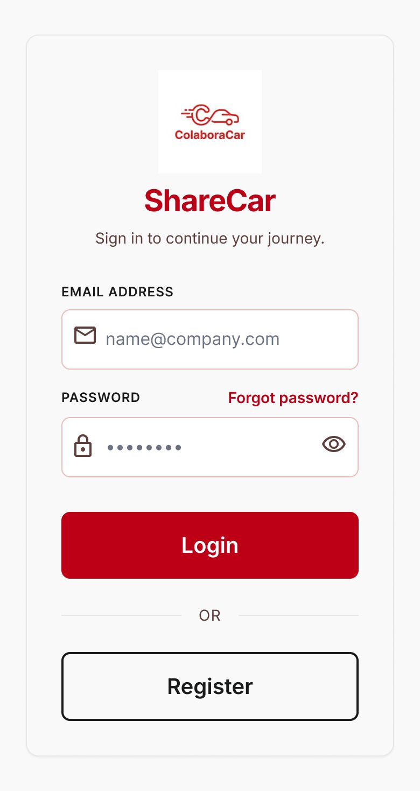

# P01 — Iniciar sesión

| Módulo | RF | Frame de referencia |
| --- | --- | --- |
| Autenticación | RF-01 | `frames/01. login.jpeg` |

## Contenido

Correo y contraseña, con acceso a registro y recuperación de contraseña.

## Ajustes respecto al frame

Manda el README raíz (sección 11).

- Solo se admiten correos `utp.edu.pe` (RN-01, RN-02); el frame muestra `name@company.com`.
- La marca es ColaboraCar, no «ShareCar».
