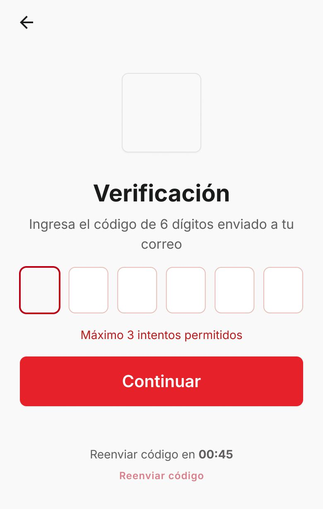

# P02 — Verificación OTP

| Módulo | RF | Frame de referencia |
| --- | --- | --- |
| Autenticación | RF-01 | `frames/02. login_verificacion.jpeg` |

## Contenido

Código de 6 dígitos enviado al correo, máximo 3 intentos y reenvío con temporizador.

## Ajustes respecto al frame

Manda el README raíz (sección 11).

- Solo se muestra la primera vez en cada dispositivo (RN-35), no en cada login.
