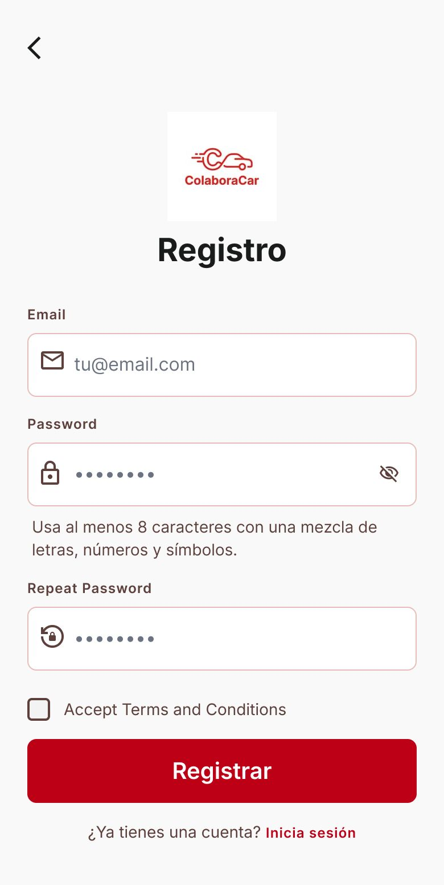

# P03 — Registro

| Módulo | RF | Frame de referencia |
| --- | --- | --- |
| Registro | RF-02 | `frames/03. registro.jpeg` |

## Contenido

Email, contraseña, confirmación y aceptación de términos y condiciones.

## Ajustes respecto al frame

Manda el README raíz (sección 11).

- Solo se admiten correos `utp.edu.pe` (RN-01, RN-02).
