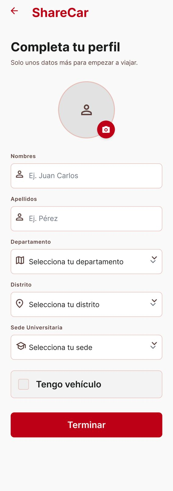

# P04 — Completar perfil

| Módulo | RF | Frame de referencia |
| --- | --- | --- |
| Registro | RF-02 | En diseño ([prompt.md](prompt.md)) · frame original `frames/04. registro_datos_personales.jpeg` |

## Frames planeados

| Frame | Vista |
| --- | --- |
| 04-A | Formulario completo, sin asistencia |
| 04-B | Con asistencia de movilidad (RF-02 B) |
| 04-C | Errores de validación (incluido el consentimiento, RN-17) |
| 04-D | «Tengo vehículo» marcado: botón «Continuar» |

## Contenido

Foto, nombres, apellidos, departamento, distrito, sede y casilla «Tengo vehículo».

## Ajustes respecto al frame

Manda el README raíz (sección 11).

- Agregar la sección de asistencia de movilidad, con consentimiento expreso (RN-17).
