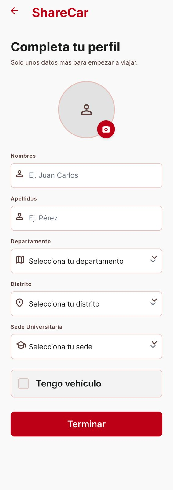

# P04 — Completar perfil

| Módulo | RF | Frame de referencia |
| --- | --- | --- |
| Registro | RF-02 | `frames/04. registro_datos_personales.jpeg` |

## Contenido

Foto, nombres, apellidos, departamento, distrito, sede y casilla «Tengo vehículo».

## Ajustes respecto al frame

Manda el README raíz (sección 11).

- Agregar la sección de asistencia de movilidad, con consentimiento expreso (RN-17).
