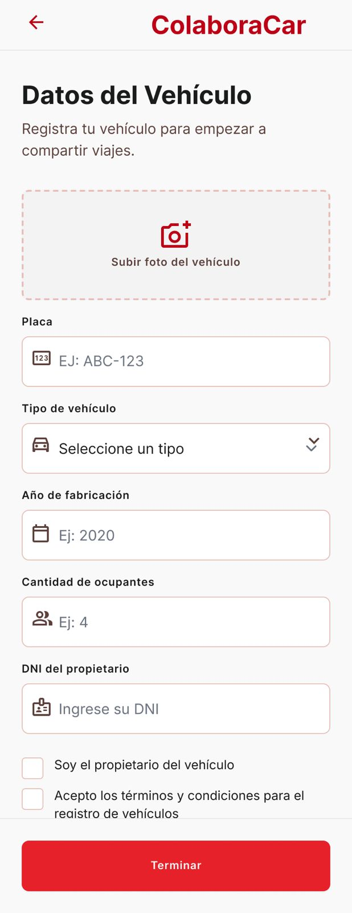

# P05 — Datos del vehículo y SOAT

| Módulo | RF | Frame de referencia |
| --- | --- | --- |
| Registro | RF-02, RF-14 | En diseño ([prompt.md](prompt.md)) · frame original `frames/05. registro_vehiculo.jpeg` |

## Frames planeados

| Frame | Vista |
| --- | --- |
| 05-A | Formulario vacío al llegar desde P04 |
| 05-B | Formulario completo con SOAT vigente |
| 05-C | SOAT no vigente y errores, con «Omitir por ahora» (RF-02 E) |
| 05-D | Tipo moto: sin sección de accesibilidad (RN-18) |

## Contenido

Foto, placa, tipo, año de fabricación, ocupantes y DNI del propietario.

## Ajustes respecto al frame

Manda el README raíz (sección 11).

- Pedir marca, modelo, color, accesibilidad y la sección SOAT (RF-02, RN-36).
