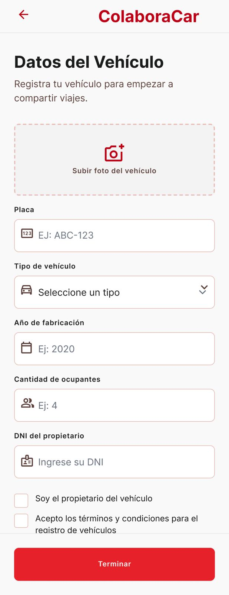

# P05 — Datos del vehículo y SOAT

| Módulo | RF | Frame de referencia |
| --- | --- | --- |
| Registro | RF-02, RF-14 | `frames/05. registro_vehiculo.jpeg` |

## Contenido

Foto, placa, tipo, año de fabricación, ocupantes y DNI del propietario.

## Ajustes respecto al frame

Manda el README raíz (sección 11).

- Pedir marca, modelo, color, accesibilidad y la sección SOAT (RF-02, RN-36).
