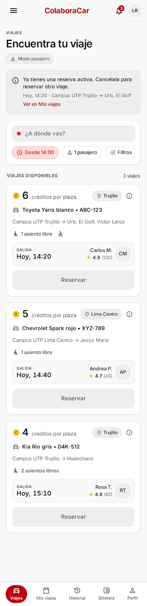

# P06 — Dashboard / viajes

| Módulo | RF | Frame de referencia |
| --- | --- | --- |
| Viajes | RF-03, RF-05, RF-13 (campana) | Rediseño aprobado: ver tabla de frames ([prompt.md](prompt.md)) |

## Frames aprobados

| Frame | Vista | Captura |
| --- | --- | --- |
| 06-A | Listado, modo pasajero | [v3.1.png](v3.1.png) |
| 06-B | Pasajero con reserva activa (RN-23) | [v3.2.png](v3.2.png) |
| 06-C | Pasajero bloqueado por cancelaciones (RN-38) | [v3.3.png](v3.3.png) |
| 06-D | Modal: filtros (RN-19) | [v3.4.png](v3.4.png) |
| 06-E | Sin resultados | [v3.5.png](v3.5.png) |
| 06-F | Modo conductor: publicar y resumen de sus viajes | [v4.1.png](v4.1.png) |
| 06-G | Conductor bloqueado para publicar (RN-30) | [v4.2.png](v4.2.png) |

Se muestra 06-B porque su fila de precio («6 créditos por plaza» en una línea) es la referencia; en 06-A (v3.1) sale partida.

Frame original del prototipo: [screen.jpeg](screen.jpeg).

## Contenido

Modo pasajero: buscador de destino, chips de filtro (hora mínima, pasajeros, «Solo vehículos accesibles») y tarjetas de viajes de todas las sedes con «Reservar». Modo conductor: «Publicar un viaje» y un resumen de sus viajes publicados con enlace a Mis viajes.

## Ajustes respecto al frame

Manda el README raíz (sección 11). El detalle y el motivo de cada cambio están en [prompt.md](prompt.md).

- Una sola hora de salida (`fecha_salida`), no un rango.
- Cada tarjeta lleva la etiqueta de ciudad (RN-49) y una línea con la ruta «origen → destino». El encabezado lleva la campana con el contador de no leídas (RF-13).
- Filtro «Solo vehículos accesibles» (RN-19) e icono de vehículo apto en la tarjeta (RN-18).
- Precio por plaza de 1 a 10 créditos (RN-13); 45 y 35 eran ilustrativos.
- «Publicar un viaje» solo en modo conductor, que muestra además sus viajes publicados (RN-24, RN-48). El pasajero no ve ese botón.
- Estados deshabilitados: reserva activa (RN-23), bloqueo del pasajero (RN-38) y bloqueo del conductor (RN-30).
- Barra inferior de 5 pestañas (Viajes, Mis viajes, Historial, Billetera, Perfil).
