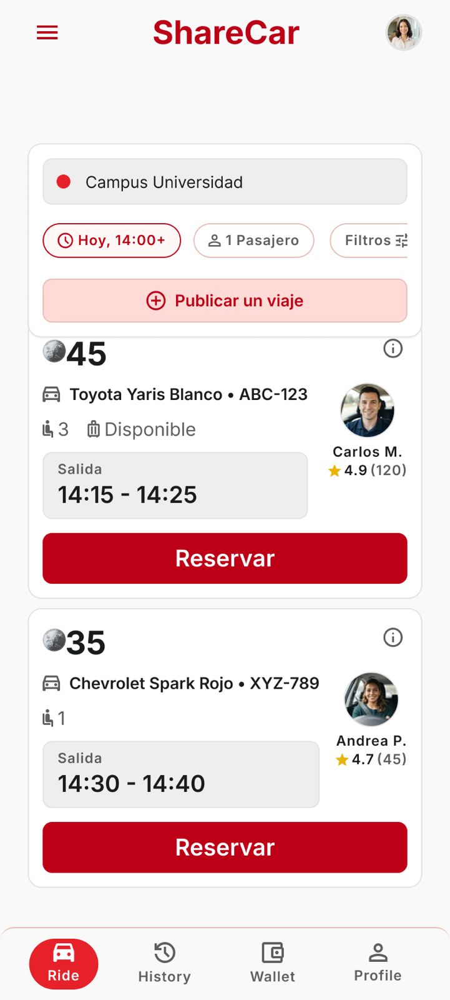

# P06 — Dashboard / viajes

| Módulo | RF | Frame de referencia |
| --- | --- | --- |
| Viajes | RF-03, RF-05, RF-13 (campana) | `frames/06. dashboard.jpeg` |

## Contenido

Buscador, filtros, botón «Publicar un viaje» y tarjetas de viajes con reserva.

## Ajustes respecto al frame

Manda el README raíz (sección 11).

- Una sola hora de salida (`fecha_salida`), no un rango.
- Cada tarjeta lleva la etiqueta de ciudad (RN-49) y el encabezado, la campana (RF-13).
- Agregar el filtro «Solo vehículos accesibles» (RN-19).
- Precio por plaza de 1 a 10 créditos (RN-13); 45 y 35 son ilustrativos.
