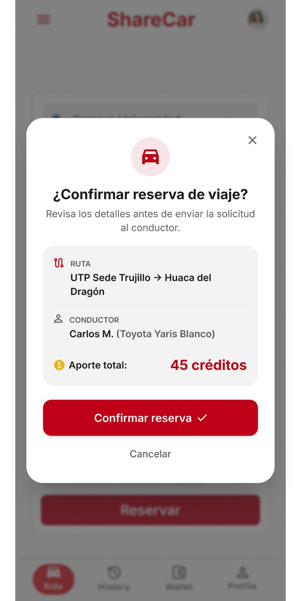

# P08 — Confirmar reserva (dashboard)

| Módulo | RF | Frame de referencia |
| --- | --- | --- |
| Viajes | RF-04 | `frames/08. dashboard_confirm_viaje.jpeg` |

## Contenido

Modal de confirmación con ruta, conductor y aporte total en créditos.

## Ajustes respecto al frame

Manda el README raíz (sección 11).

- La reserva se confirma al instante, sin aprobación del conductor, y retiene los créditos (RF-04).
- Mostrar el total y el saldo disponible después de reservar.
- Precio por plaza de 1 a 10 créditos (RN-13).
