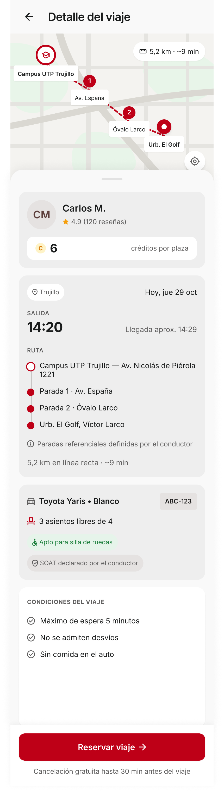

# P09 — Detalle del viaje

| Módulo | RF | Frame de referencia |
| --- | --- | --- |
| Viajes | RF-03, RF-04 | Rediseño aprobado: ver tabla de frames ([prompt.md](prompt.md)) |

## Frames aprobados

| Frame | Vista | Captura |
| --- | --- | --- |
| 09-A | Detalle, pasajero puede reservar | [v2.1.png](v2.1.png) |
| 09-B | Modo lectura: ya es tu reserva (desde Mis viajes) | [v2.2.png](v2.2.png) |
| 09-C | Pasajero bloqueado por cancelaciones (RN-38) | [v2.3.png](v2.3.png) |
| 09-D | Viaje que ya no está disponible | [v2.4.png](v2.4.png) |

Frame original del prototipo: [screen.jpeg](screen.jpeg).

## Contenido

Mapa con la ruta en líneas rectas, conductor con calificación, precio por plaza, salida con fecha y llegada aproximada, ruta en texto con paradas referenciales, vehículo con asientos libres, accesibilidad y SOAT declarado, y condiciones del viaje.

## Ajustes respecto al frame

Manda el README raíz (sección 11). El detalle y el motivo de cada cambio están en [prompt.md](prompt.md).

- «Cancelación gratuita hasta 30 min antes del viaje» (RN-25); se cancela en Mis viajes.
- Sin «A/C activo», «Conductor frecuente» ni «Tráfico fluido». Se agregan el chip «Apto para silla de ruedas» si el vehículo es apto (RN-18), «SOAT declarado por el conductor» (RN-36) y la lista de condiciones (RF-03).
- Ruta con líneas rectas, también como lista en texto con «Paradas referenciales definidas por el conductor» (RN-29, RNF-11), distancia en línea recta y duración a 35 km/h (RF-03).
- Chip de ciudad «Trujillo» (RN-49) y una sola hora de salida en 24 h.
- Precio por plaza de 1 a 10 créditos (RN-13).
- Encabezado de flujo «←», sin barra inferior.
- Estados: modo lectura de la propia reserva (09-B), bloqueo por cancelaciones (09-C), reserva activa en otro viaje (layout de 09-C con la franja de P06-B, RN-23) y viaje no disponible (09-D).

## Ajustes en la implementación

- «créditos por plaza» pegado al número, como en P06-B.
- Relleno inferior de la página igual a la altura de la barra fija, fuera de la tarjeta de condiciones.
- Título «Detalle del viaje» con mayúscula solo al inicio (09-D salió «Detalle Del Viaje»).
