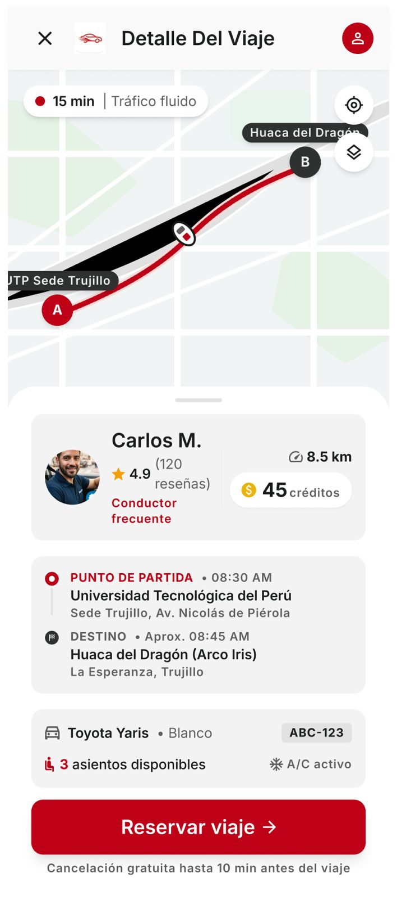

# P09 — Detalle del viaje

| Módulo | RF | Frame de referencia |
| --- | --- | --- |
| Viajes | RF-03, RF-04 | `frames/09. dashboard_detalle_viaje.jpeg` |

## Contenido

Mapa de la ruta, datos del conductor, puntos de partida y destino, vehículo y asientos.

## Ajustes respecto al frame

Manda el README raíz (sección 11).

- «Cancelación gratuita hasta 30 min antes del viaje» (RN-25); se cancela en Mis viajes.
- Quitar «A/C activo» y «Conductor frecuente»; agregar distintivo de vehículo apto (RN-18), «SOAT declarado por el conductor» (RN-36) y la lista de condiciones.
- Precio por plaza de 1 a 10 créditos (RN-13).
