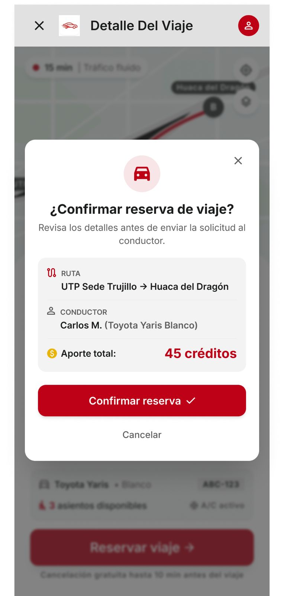

# P10 — Confirmar reserva (detalle)

| Módulo | RF | Frame de referencia |
| --- | --- | --- |
| Viajes | RF-04 | `frames/10. confirm_detalle_viaje.jpeg` |

## Contenido

Mismo modal de confirmación, abierto desde el detalle del viaje.

## Ajustes respecto al frame

Manda el README raíz (sección 11).

- La reserva se confirma al instante y retiene los créditos (RF-04).
- Mostrar el total y el saldo disponible después de reservar.
