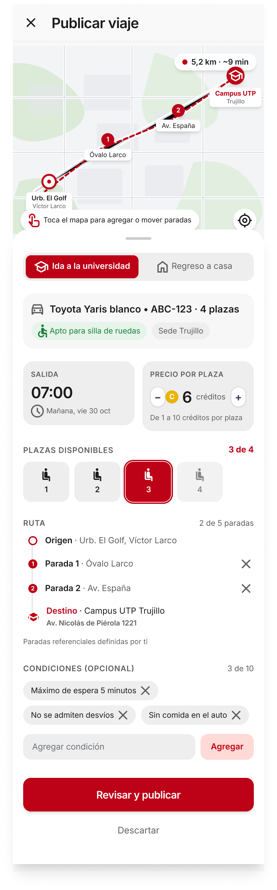

# P11 — Publicar viaje

| Módulo | RF | Frame de referencia |
| --- | --- | --- |
| Viajes | RF-05 | Rediseño aprobado: ver tabla de frames ([prompt.md](prompt.md)) |

## Frames aprobados

| Frame | Vista | Captura |
| --- | --- | --- |
| 11-A | Formulario completo | [v2.3.png](v2.3.png) |
| 11-B | Errores de validación (salida fuera de horario, SOAT) | [v2.2.png](v2.2.png) |
| 11-C | Bloqueo por cancelaciones (RN-30) | [v1.3.png](v1.3.png) |

Frame original del prototipo: [screen.jpeg](screen.jpeg).

## Contenido

Mapa con paradas, sentido (ida/regreso), hora de salida, precio por plaza y plazas disponibles.

## Ajustes respecto al frame

Manda el README raíz (sección 11). Detalle y motivo de cada cambio en [prompt.md](prompt.md).

- Precio en créditos enteros de 1 a 10, con stepper (RN-13). Sin «S/» ni «Tarifa recomendada».
- Salida con fecha y hora en 24 h, entre 06:00 y 23:00 (RN-12).
- Ruta con líneas rectas y también como lista en texto, hasta 5 paradas (RN-10, RN-29, RNF-11).
- Condiciones opcionales, hasta 10 (RF-05).
- Vehículo visible, con sus plazas como máximo del selector (RN-11).
- Accesibilidad del vehículo en modo lectura: chip «Apto para silla de ruedas», o «Sin accesibilidad declarada · Configurar en mi vehículo» hacia P16 (RN-18). No se activa por viaje.
- Estados de bloqueo: sin vehículo (RN-24), cancelaciones (RN-30) y SOAT vencido en la fecha (RN-37).
