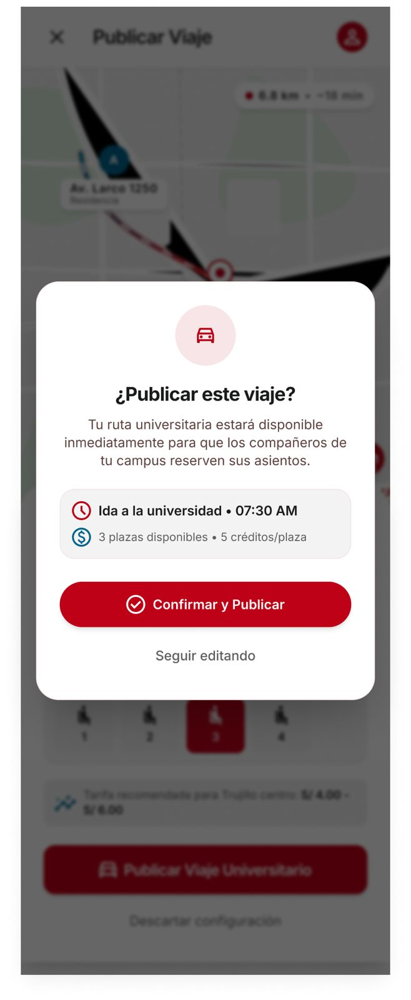

# P12 — Confirmar publicación

| Módulo | RF | Frame de referencia |
| --- | --- | --- |
| Viajes | RF-05 | `frames/12. confirm_publicar_viaje.jpeg` |

## Contenido

Modal de confirmación con el resumen del viaje a publicar.
