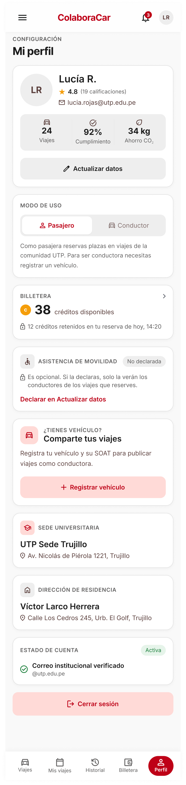

# P13 — Perfil — pasajero (con modal de cambio de modo)

| Módulo | RF | Frame de referencia |
| --- | --- | --- |
| Perfil | RF-01, RF-14 | Rediseño aprobado: 13-A [v1.1](v1.1.png), 13-B [v1.2](v1.2.png), 13-C [v1.3](v1.3.png), 13-D [v1.4](v1.4.png), 13-E [v1.5](v1.5.png) ([prompt.md](prompt.md)). Frame original: [screen.jpeg](screen.jpeg) |

Ajustes respecto al diseño, a resolver en la implementación: ver «Decisión» en [prompt.md](prompt.md) (estadísticas en tres bloques, «—» sin viajes, hojas inferiores ancladas con velo, texto neutro).

## Contenido

Datos, estadísticas, sede universitaria, dirección de residencia y estado de cuenta.

## Ajustes respecto al frame

Manda el README raíz (sección 11).

- Quitar «Cambiar sede» y «Modificar casa».
- Agregar el saldo con acceso a la billetera y la calificación.
- El cambio de modo usa un modal de confirmación (RN-48).
- La estadística se llama «Cumplimiento» (RN-28).
