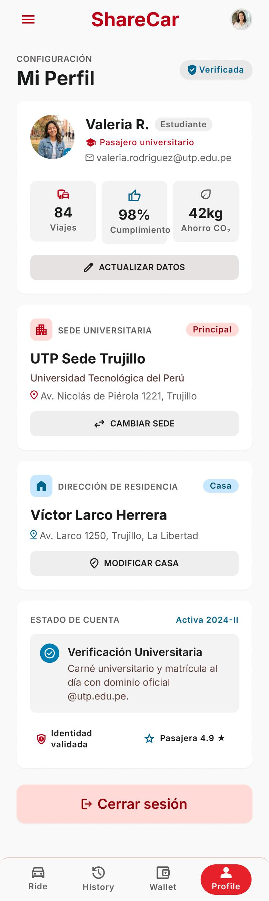

# P13 — Perfil — pasajero (con modal de cambio de modo)

| Módulo | RF | Frame de referencia |
| --- | --- | --- |
| Perfil | RF-01, RF-14 | `frames/13. perfil_pasajero.jpeg` |

## Contenido

Datos, estadísticas, sede universitaria, dirección de residencia y estado de cuenta.

## Ajustes respecto al frame

Manda el README raíz (sección 11).

- Quitar «Cambiar sede» y «Modificar casa».
- Agregar el saldo con acceso a la billetera y la calificación.
- El cambio de modo usa un modal de confirmación (RN-48).
- La estadística se llama «Cumplimiento» (RN-28).
