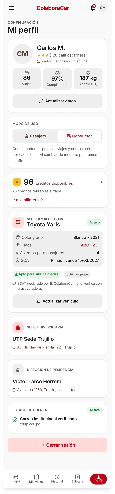

# P14 — Perfil — conductor (con modal de cambio de modo)

| Módulo | RF | Frame de referencia |
| --- | --- | --- |
| Perfil | RF-01, RF-14 | Rediseño aprobado: 14-A [v1.1](v1.1.png), 14-B [v1.2](v1.2.png), 14-C [v1.3](v1.3.png), 14-D [v1.4](v1.4.png) ([prompt.md](prompt.md)). Frame original: [screen.jpeg](screen.jpeg) |

Ajustes respecto al diseño, a resolver en la implementación: ver «Decisión» en [prompt.md](prompt.md) (etiqueta y enlace único de la tarjeta de billetera, velo de los modales y franja de SOAT vencido).

## Contenido

Igual que el de pasajero, más el vehículo registrado.

## Ajustes respecto al frame

Manda el README raíz (sección 11).

- Quitar «Cambiar sede» y «Modificar casa».
- Agregar el saldo con acceso a la billetera y la calificación.
- «Puntualidad» pasa a llamarse «Cumplimiento» (RN-28).
- Correo de ejemplo `utp.edu.pe`, no `sharecar.pe`.

## Implementación (2026-11-21)

- Frontend: [ProfilePage.tsx](../../../app-utp-movilidad-colaborativa/src/features/profile/pages/ProfilePage.tsx) y [ModeChangeSheet.tsx](../../../app-utp-movilidad-colaborativa/src/features/profile/components/ModeChangeSheet.tsx). Backend: `PATCH /users/me/mode` y `tripInProgress` en `GET /users/me`.
- Billetera: una sola entrada (toda la tarjeta con chevron), sin el enlace «Ir a la billetera».
- Sin SOAT declarado, la fila muestra «No declarado» y no hay chip ni nota (texto no definido en el README).
- La campana sigue sin contador: P18 (RF-13) no existe todavía.

