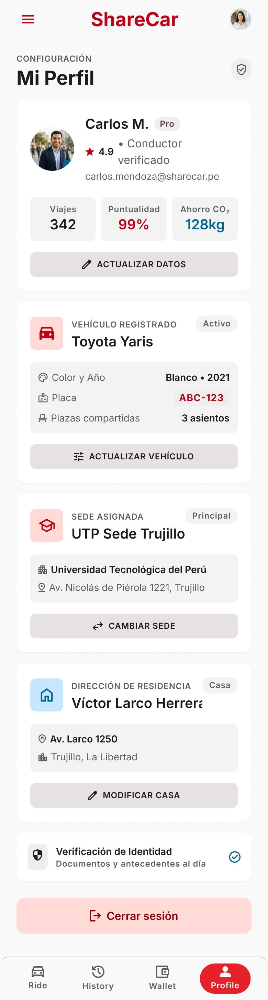

# P14 — Perfil — conductor (con modal de cambio de modo)

| Módulo | RF | Frame de referencia |
| --- | --- | --- |
| Perfil | RF-01, RF-14 | `frames/14. perfil_conductor.jpeg` |

## Contenido

Igual que el de pasajero, más el vehículo registrado.

## Ajustes respecto al frame

Manda el README raíz (sección 11).

- Quitar «Cambiar sede» y «Modificar casa».
- Agregar el saldo con acceso a la billetera y la calificación.
- «Puntualidad» pasa a llamarse «Cumplimiento» (RN-28).
- Correo de ejemplo `utp.edu.pe`, no `sharecar.pe`.
