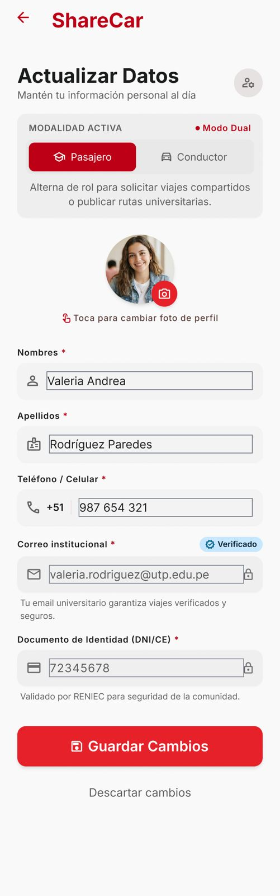

# P15 — Actualizar datos

| Módulo | RF | Frame de referencia |
| --- | --- | --- |
| Perfil | RF-14 | `frames/15. perfil_actualizar_datos.jpeg` |

## Contenido

Foto y datos personales.

## Ajustes respecto al frame

Manda el README raíz (sección 11).

- El usuario elige tipo de documento (DNI o CE) e ingresa el número una sola vez; luego queda bloqueado (RN-14).
- La modalidad se cambia desde el perfil (13, 14), no en este formulario (RN-48).
- Agregar la sección de asistencia de movilidad (RN-17).
