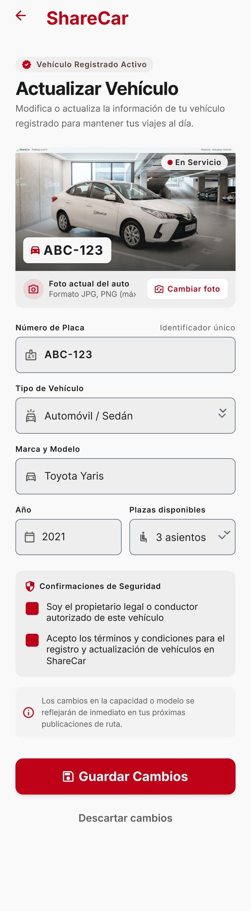

# P16 — Actualizar vehículo y SOAT

| Módulo | RF | Frame de referencia |
| --- | --- | --- |
| Perfil | RF-14 | `frames/16. perfil_actualizar_vehiculo.jpeg` |

## Contenido

Foto, placa, tipo, marca y modelo, año y plazas del vehículo.

## Ajustes respecto al frame

Manda el README raíz (sección 11).

- Pedir color, accesibilidad y la sección SOAT (RF-14, RN-36).
