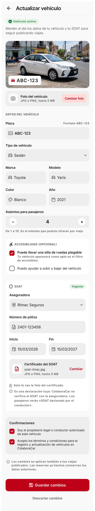

# P16 — Actualizar vehículo y SOAT

| Módulo | RF | Frame de referencia |
| --- | --- | --- |
| Perfil | RF-14 | Rediseño aprobado: ver tabla de frames ([prompt.md](prompt.md)) |

## Frames aprobados

| Frame | Vista | Captura |
| --- | --- | --- |
| 16-A | Formulario completo (SOAT vigente) | [v2.1.png](v2.1.png) |
| 16-B | Errores de validación (placa repetida, póliza, SOAT no vigente) | [v3.1.png](v3.1.png) |
| 16-C | Tipo moto: sin sección de accesibilidad (RN-18) | [v4.1.png](v4.1.png) |
| 16-D | SOAT por vencer | [v4.2.png](v4.2.png) |

Frame original del prototipo: [screen.jpeg](screen.jpeg).

## Contenido

Foto del vehículo, placa, tipo, marca, modelo, color, año y asientos para pasajeros; accesibilidad opcional; SOAT (aseguradora, póliza, fechas y foto del certificado); confirmaciones y guardado.

## Ajustes respecto al frame

Manda el README raíz (sección 11). El detalle y el motivo de cada cambio están en [prompt.md](prompt.md).

- Encabezado de flujo «←» + «Actualizar vehículo», sin «ShareCar» ni barra inferior. Sin la insignia «En Servicio».
- Marca y modelo separados, y se agrega el color (RF-14). Asientos de 1 a 10 con stepper (RN-09).
- Accesibilidad opcional con dos checks (RN-18). Con tipo Moto la sección no se muestra (decisión del usuario del 2026-11-01).
- Sección SOAT obligatoria con aseguradora, póliza, fechas y foto del certificado, más la nota de que es una declaración del conductor y que la foto solo la ve él (RN-15, RN-36).
- Solo el check de términos es obligatorio (RN-16).
- Nota: los cambios se copian a los viajes publicados y las reservas conservan su copia (RF-14).
- Estados: errores de validación (16-B) y SOAT por vencer (16-D).
