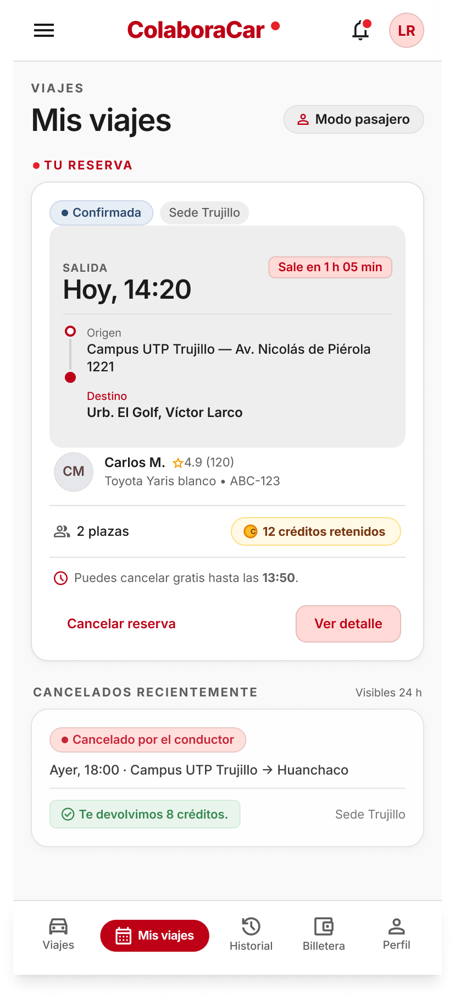
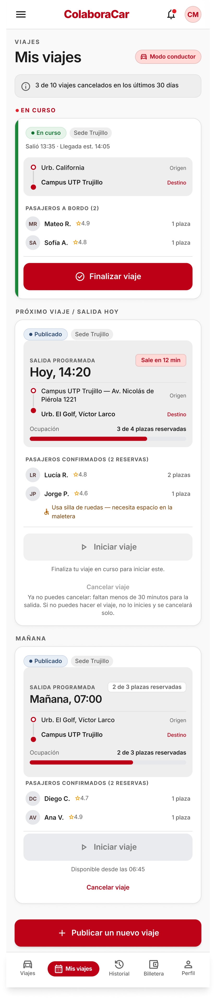

# P17 — Mis viajes (con modales de cancelar, iniciar y finalizar)

| Módulo | RF | Frame de referencia |
| --- | --- | --- |
| Mis viajes | RF-06, RF-07 | Diseño aprobado: ver tabla de frames ([prompt.md](prompt.md)) |

## Contenido

Viajes próximos y en curso del usuario. El pasajero cancela su reserva y el conductor su viaje hasta 30 minutos antes de la salida. El conductor confirma el inicio marcando qué pasajeros subieron y finaliza el viaje al llegar.

## Frames aprobados

| Frame | Vista | Captura |
| --- | --- | --- |
| 17-A | Pasajero con reserva Confirmada | [v1.2.png](v1.2.png) |
| 17-B | Conductor: en curso, hoy y mañana | [v2.1.png](v2.1.png) |
| 17-C | Modal: cancelar reserva | [v1.4.png](v1.4.png) |
| 17-D | Modal: cancelar viaje | [v2.2.png](v2.2.png) |
| 17-E | Modal: ¿Quiénes subieron? | [v2.3.png](v2.3.png) |
| 17-F | Modal: finalizar viaje | [v1.7.png](v1.7.png) |
| 17-G | Estado vacío (pasajero) | [v2.4.png](v2.4.png) |
| 17-H | Pasajero con reserva En viaje | [v2.5.png](v2.5.png) |

## Ajustes respecto al diseño

Manda el README raíz. Las capturas son una referencia de alta fidelidad, no un plano exacto.

- Logotipo sin el punto rojo (17-H lo muestra) y sin el texto «Salió 14:22» encimado en el encabezado de 17-H.
- El fondo atenuado de los modales (17-D, 17-E, 17-F) es la versión anterior de 17-B: en la app va el 17-B aprobado, con un velo negro al 40 % y sin bandas a los lados.
- En la tarjeta de mañana de 17-B, «2 de 3 plazas reservadas» aparece dos veces: se deja solo la fila de ocupación con barra.
- Variantes que no se diseñaron: 17-G en modo conductor, 17-E sin pasajeros, 17-A fuera de plazo y 17-B con el límite de RN-30 (ver la sección Decisión de [prompt.md](prompt.md)).
