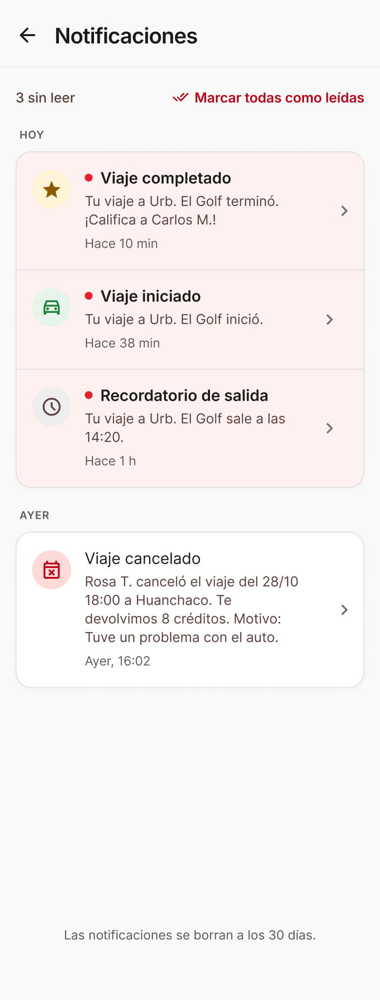
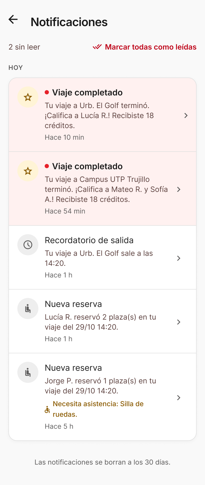

# P18 — Notificaciones

| Módulo | RF | Frame de referencia |
| --- | --- | --- |
| Notificaciones | RF-13 | Diseño aprobado: ver tabla de frames ([prompt.md](prompt.md)) |

## Contenido

Bandeja con la más reciente primero (hasta 50), agrupada por día: icono por tipo, título, mensaje y hace cuánto llegó. Las no leídas se distinguen con un punto rojo y fondo rojo muy suave. Al tocar una se marca como leída y abre la pantalla relacionada (Mis viajes, historial, calificar o billetera). Botón «Marcar todas como leídas». Vacío: «No tienes notificaciones». Se abre desde la campana del encabezado.

## Frames aprobados

| Frame | Vista | Captura |
| --- | --- | --- |
| 18-A | Bandeja de la pasajera (Lucía R.), con 3 sin leer | [v1.1.png](v1.1.png) |
| 18-B | Bandeja del conductor (Carlos M.), con «Nueva reserva» y asistencia de movilidad (RN-22) | [v1.2.png](v1.2.png) |
| 18-C | Todo leído (después de «Marcar todas como leídas») | [v2.1.png](v2.1.png) |
| 18-D | Estado vacío | [v1.4.png](v1.4.png) |

## Ajustes respecto al diseño

Manda el README raíz (RF-13, RN-22, RN-32 a RN-34). Las capturas son una referencia de alta fidelidad, no un plano exacto.

- Pantalla de flujo: encabezado «←» + «Notificaciones», con línea divisoria inferior, sin barra inferior (se abre desde la campana).
- Un único componente de fila: chevron «›» a 16 px del borde derecho en todas las filas (en las capturas la primera fila de cada tarjeta lo tiene más a la derecha).
- Icono de «Viaje completado»: estrella rellena (18-B la muestra de contorno).
- Leyenda «Las notificaciones se borran a los 30 días.» 24 px debajo de la última tarjeta, no al fondo de la pantalla.
- Con todo leído, la fila superior dice «Todo leído» y el enlace queda deshabilitado (#686C75).
- Los textos de los mensajes son los literales de la tabla de RF-13. El texto de asistencia solo aparece en las notificaciones del conductor (RN-22) y puede ocupar dos líneas.
- Estado vacío: «Buscar viajes» para el pasajero y «Publicar viaje» para el conductor.
