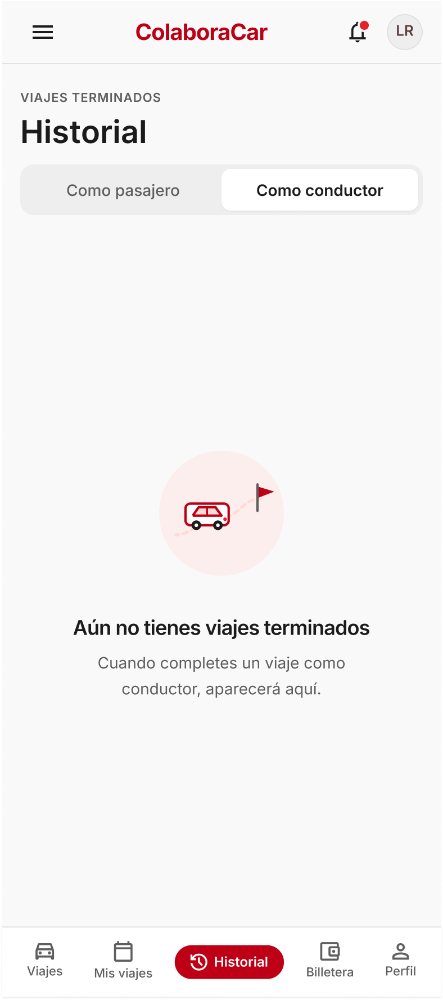

# P19 — Historial

| Módulo | RF | Frame de referencia |
| --- | --- | --- |
| Historial | RF-09, RF-10 | Diseño aprobado: `v3.1.png` (19-A), `v2.2.png` (19-B), `v2.3.png` (19-C). Bitácora en [prompt.md](prompt.md) |

## Contenido

Viajes terminados, cancelados o perdidos, como pasajero y como conductor, con acceso a calificar durante 24 horas desde que terminó el viaje.

## Ajustes respecto al diseño

Ver «Decisión» en [prompt.md](prompt.md): avatares superpuestos legibles, plazo de calificación calculado con `fecha_fin + dias_para_calificar` (24 h), calificación parcial del conductor, viaje sin pasajeros, estado vacío de la pestaña «Como pasajero» y error de carga.
