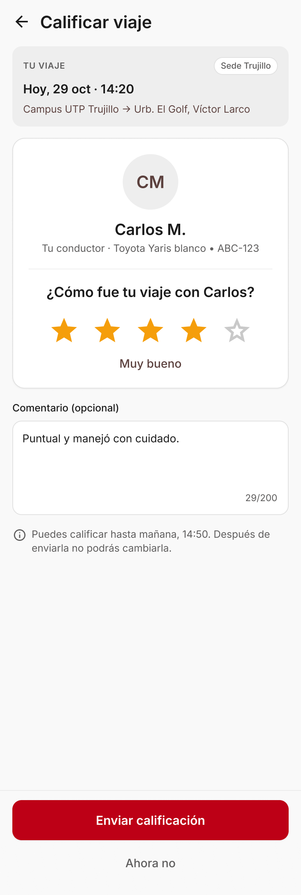
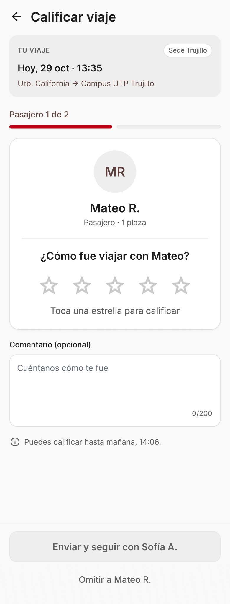
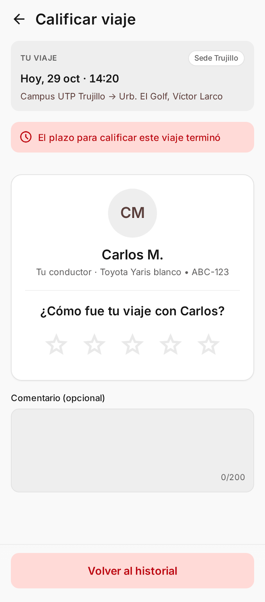

# P20 — Calificar

| Módulo | RF | Frame de referencia |
| --- | --- | --- |
| Calificaciones | RF-10 | Diseño aprobado: `v1.1.png` (20-A), `v1.2.png` (20-B), `v2.1.png` (20-C), `v1.4.png` (20-D). Bitácora en [prompt.md](prompt.md) |

## Contenido

El pasajero califica al conductor y el conductor a cada pasajero que subió: 1 a 5 estrellas y comentario opcional.

## Entrada desde otras pantallas

- Desde P17 Mis viajes: al tocar «Finalizar viaje» (frame 17-F), el conductor llega a esta pantalla con los pasajeros que subieron. Decisión de flujo de P17, adoptada sin objeción el 2026-10-29.
- Desde P19 Historial: «Calificar a …» (pasajero) o «Calificar pasajeros (N)» (conductor), con los pasajeros `COMPLETADA` aún sin calificar. Plazo de 24 horas desde `fecha_fin` (`dias_para_calificar` = 1, decisión del 2026-11-21). Al volver, la tarjeta del historial muestra la calificación dada.

## Ajustes respecto al diseño

Ver «Decisión» en [prompt.md](prompt.md): velo de los modales sin bandas, etiquetas del puntaje, cierre de la secuencia del conductor, límite del comentario, errores 409 y plazo de 24 h.
