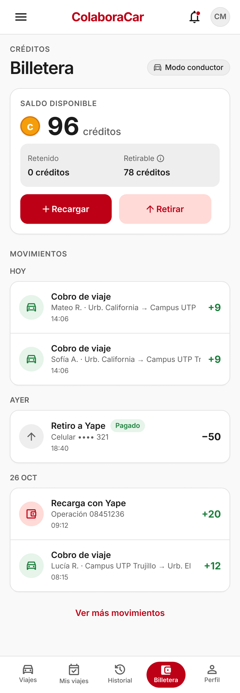
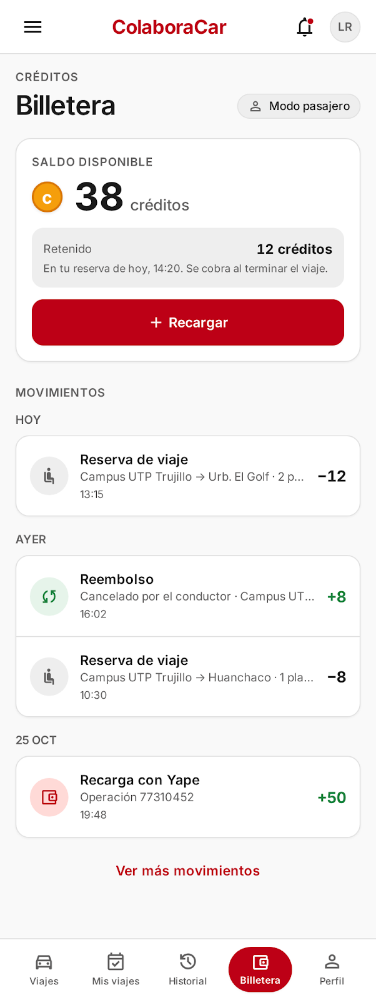

# P21 — Billetera (con modales de recarga y retiro)

| Módulo | RF | Frame de referencia |
| --- | --- | --- |
| Billetera | RF-11, RF-12 | Diseño aprobado: ver tabla de frames ([prompt.md](prompt.md)) |

## Contenido

Saldo disponible y retenido y movimientos. Recarga simulada con Yape (monto y código de operación, leyenda «Modo de prueba») y, para el conductor, retiro de lo ganado a su número de Yape.

## Frames aprobados

| Frame | Vista | Captura |
| --- | --- | --- |
| 21-A | Conductor: saldo, retirable y movimientos | [v1.1.png](v1.1.png) |
| 21-B | Pasajero: retenido, sin retiro | [v1.2.png](v1.2.png) |
| 21-C | Modal: recargar créditos (simulado) | [v1.3.png](v1.3.png) |
| 21-D | Recarga exitosa | [v1.4.png](v1.4.png) |
| 21-E | Modal: retirar a Yape | [v1.5.png](v1.5.png) |
| 21-F | Conductor con retiro en proceso | [v1.6.png](v1.6.png) |

## Ajustes respecto al diseño

Manda el README raíz. Las capturas son una referencia de alta fidelidad, no un plano exacto.

- Los modales van sobre la billetera del usuario que recarga o retira (en 21-C y 21-D el fondo es la de Carlos, aunque el saldo es el de Lucía).
- Descripciones de movimientos en una línea con puntos suspensivos; el monto siempre visible.
- Falta el retiro rechazado: chip «Rechazado» con el motivo y la fila «Retiro devuelto» (RF-12).
- Mensajes de validación y decisiones de flujo en [prompt.md](prompt.md).
